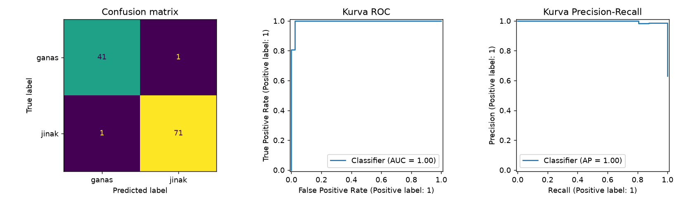

# Evaluasi Model Klasifikasi

## Tujuan pembelajaran

- [x] Membaca *confusion matrix* dan menurunkan metrik darinya.
- [x] Menafsirkan ROC-AUC dan PR-AUC, serta kapan memakainya.
- [x] Mengubah ambang keputusan untuk menukar precision dan recall.
- [x] Mengenal metrik tambahan dan batasannya.

!!! info "Prasyarat"
    Definisi dasar *accuracy*, *precision*, *recall*, dan F1 ada di [Metrik Evaluasi](../fundamentals/evaluation-metrics.md). Lesson ini memakainya pada model nyata.

## Dari prediksi ke metrik

Model menghasilkan **probabilitas** (`predict_proba`), lalu kelas ditentukan dengan **ambang** (*threshold*), biasanya 0,5. Metrik yang berbeda menilai bagian yang berbeda:

| Metrik | Bergantung pada ambang? | Fungsi |
|---|---|---|
| *Accuracy*, precision, recall, F1 | Ya | Kinerja pada satu ambang tertentu |
| ROC-AUC | Tidak | Kemampuan mengurutkan positif di atas negatif |
| PR-AUC (*average precision*) | Tidak | Seperti ROC-AUC, lebih peka pada kelas positif langka |

$$
\text{TPR (recall)} = \frac{TP}{TP+FN}, \qquad \text{FPR} = \frac{FP}{FP+TN}
$$

Kurva ROC memplot TPR terhadap FPR untuk semua ambang. ROC-AUC = peluang sebuah positif acak mendapat skor lebih tinggi daripada sebuah negatif acak (1,0 sempurna, 0,5 setara menebak).

## Implementasi langkah demi langkah

Model yang dinilai adalah regresi logistik berskala dari [pelajaran sebelumnya](logistic-regression.md), pada data uji Breast Cancer. Program `examples/classification/evaluation.py`; program lengkap ada di akhir bagian ini.

### Langkah 1: menyiapkan model

```python title="evaluation.py" linenums="21"
--8<-- "classification/evaluation.py:21:29"
```

Pembagian data dan pelatihan sama dengan pelajaran sebelumnya: `model` dilatih pada data latih dan siap dinilai pada `X_test`, `y_test`. `OUT` adalah folder tujuan gambar.

### Langkah 2: prediksi kelas dan probabilitas

**Konsep.** Model menghasilkan **probabilitas**, lalu kelas ditentukan dengan **ambang** (*threshold*), biasanya 0,5.

```python title="evaluation.py" linenums="31"
--8<-- "classification/evaluation.py:31:33"
```

`predict` mengembalikan label (0 atau 1). `predict_proba` mengembalikan tabel probabilitas dengan satu kolom per kelas; `[:, 1]` mengambil probabilitas kelas 1 (jinak) untuk semua baris. Kita memerlukan probabilitas untuk ROC, PR, dan ambang.

### Langkah 3: confusion matrix

**Konsep.** *Confusion matrix* menghitung berapa sampel tiap kelas sebenarnya yang diprediksi sebagai tiap kelas. Untuk dua kelas hasilnya tabel 2×2.

```python title="evaluation.py" linenums="35"
--8<-- "classification/evaluation.py:35:39"
```

`confusion_matrix(y_test, y_pred)` mengembalikan matriks dengan **baris = label sebenarnya** dan **kolom = prediksi**, urutan kelas 0 lalu 1. `.ravel()` meratakannya menjadi `[TN, FP, FN, TP]` yang langsung disimpan ke empat variabel. Perhatikan: karena kelas `1` dianggap "positif" oleh scikit-learn, **TP** = jinak yang diprediksi jinak dan **FN** = jinak yang diprediksi ganas.

```text
--8<-- "expected/classification/evaluation.txt:1:4"
```

**Interpretasi.** Dari 42 kasus ganas, 41 diprediksi benar dan 1 diprediksi jinak (**negatif palsu bagi deteksi ganas**). Dari 72 kasus jinak, 71 benar dan 1 diprediksi ganas. Total 112 benar dari 114.

### Langkah 4: laporan metrik dan metrik berbasis probabilitas

```python title="evaluation.py" linenums="41"
--8<-- "classification/evaluation.py:41:44"
```

`classification_report(..., target_names=[...])` memberi nama kelas pada laporan. `roc_auc_score(y_test, y_proba)` dan `average_precision_score(y_test, y_proba)` menerima **probabilitas**, bukan label, sehingga tidak bergantung pada ambang tertentu.

```text
--8<-- "expected/classification/evaluation.txt:5:15"
```

**Interpretasi.** *Precision* dan *recall* kelas ganas 0,976; kelas jinak 0,986. Karena *recall* kelas ganas = 41/(41+1), satu kasus ganas yang terlewat sudah menurunkannya ke 0,976. ROC-AUC 0,995 dan PR-AUC 0,997: model hampir sempurna **mengurutkan** sampel dari paling mungkin jinak hingga paling mungkin ganas. Dengan hanya 114 data uji, nilai ini punya ketidakpastian dan akan lebih rendah pada data klinis yang lebih sulit.

### Langkah 5: menggeser ambang keputusan

**Tujuan.** Menukar *precision* dan *recall* sesuai biaya kesalahan. Bila yang ingin kita tangkap adalah kasus **ganas**, "positif" harus berarti ganas.

```python title="evaluation.py" linenums="46"
--8<-- "classification/evaluation.py:46:55"
```

| Kode | Penjelasan |
|---|---|
| `y_malignant = (y_test == 0).astype(int)` | Label baru: 1 bila sebenarnya ganas, 0 bila jinak. |
| `p_malignant = 1 - y_proba` | Probabilitas ganas = 1 dikurangi probabilitas jinak. |
| `(p_malignant >= t).astype(int)` | Prediksi "ganas" bila probabilitasnya mencapai ambang `t`. |
| `missed` | Jumlah kasus ganas sebenarnya yang tidak ditandai ganas (negatif palsu). |

```text
--8<-- "expected/classification/evaluation.txt:17:22"
```

| Ambang | Precision ganas | Recall ganas | Ganas terlewat |
|---|---|---|---|
| 0,1 | 0,788 | 0,976 | 1 |
| 0,3 | 0,891 | 0,976 | 1 |
| 0,5 | 0,976 | 0,976 | 1 |
| 0,7 | 1,000 | 0,952 | 2 |
| 0,9 | 1,000 | 0,881 | 5 |

**Interpretasi.** Menaikkan ambang membuat model lebih "pelit" menyebut ganas: *precision* naik tetapi *recall* turun (pada 0,9, 5 kasus ganas terlewat). Menurunkan ambang menambah alarm palsu (*precision* turun ke 0,788 pada 0,1). Pada ambang 0,1 satu kasus ganas **tetap terlewat**: model sangat yakin salah pada sampel itu, sehingga tidak semua kesalahan dapat diperbaiki dengan mengubah ambang. Ambang yang tepat ditentukan oleh **biaya kesalahan** dan harus dipilih dengan data validasi, bukan data uji.

### Langkah 6: gambar confusion matrix, ROC, dan PR

```python title="evaluation.py" linenums="57"
--8<-- "classification/evaluation.py:57:69"
```

`ConfusionMatrixDisplay`, `RocCurveDisplay`, dan `PrecisionRecallDisplay` menggambar langsung dari label dan probabilitas pada sumbu (`ax`) yang kita berikan; `from_predictions` berarti masukannya prediksi yang sudah dihitung.



*(Label sumbu pada gambar mengikuti bahasa bawaan scikit-learn.)*

**Cara membaca.**

- **Confusion matrix** (kiri): diagonal (41 dan 71) adalah prediksi benar; sel di luar diagonal (1 dan 1) adalah kesalahan.
- **Kurva ROC** (tengah): sumbu-x *false positive rate*, sumbu-y *true positive rate* (recall) untuk semua ambang. Kurva yang menempel ke sudut kiri atas berarti model memisahkan kelas dengan baik; diagonal berarti tebakan acak. Luas di bawah kurva = ROC-AUC.
- **Kurva Precision-Recall** (kanan): sumbu-x *recall*, sumbu-y *precision*; kurva yang menempel ke sudut kanan atas berarti baik. Lebih informatif daripada ROC pada data sangat timpang.

??? example "Program lengkap (`evaluation.py`)"
    ```python title="evaluation.py" linenums="1"
    --8<-- "classification/evaluation.py"
    ```

## Metrik tambahan

| Metrik | Gunanya | Catatan |
|---|---|---|
| *Balanced accuracy* | Rata-rata recall per kelas | Lebih adil daripada *accuracy* pada data timpang |
| *Matthews correlation coefficient* (MCC) | Satu angka yang memperhitungkan keempat sel *confusion matrix* | Tetap informatif pada data timpang |
| *Log loss* | Menilai kualitas probabilitas | Menghukum prediksi yakin yang salah |
| Macro/weighted average | Merangkum metrik multikelas | *Macro* memperlakukan semua kelas setara |

## Kesalahan umum

!!! warning "Hindari"
    - Menganggap kelas `1` selalu kelas yang penting; periksa `pos_label`.
    - Memakai ROC-AUC pada data sangat timpang tanpa melihat PR-AUC.
    - Memilih ambang berdasarkan data uji.
    - Melaporkan satu angka tanpa *confusion matrix*.
    - Menganggap `predict_proba` selalu terkalibrasi.

## Latihan

1. Hitung manual precision dan recall kelas jinak dari *confusion matrix* [[41, 1], [1, 71]].
2. Tambahkan `balanced_accuracy_score` dan `matthews_corrcoef`.
3. Ulangi tabel ambang untuk kelas jinak sebagai positif. Bagaimana polanya?
4. Untuk skrining penyakit, ambang berapa yang Anda pilih dari tabel di atas dan mengapa?

## Ringkasan

Metrik berbasis ambang menilai satu titik operasi; ROC-AUC dan PR-AUC menilai pengurutan. Ambang mengatur pertukaran precision dan recall sesuai biaya kesalahan. Selalu baca *confusion matrix* dan periksa kelas positif.

Berikutnya: [Kelas Tidak Seimbang dan Validasi Silang](imbalance-cv.md).
