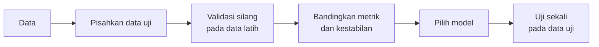

# Perbandingan dan Pemilihan Model

## Tujuan pembelajaran

- [x] Membandingkan beberapa model klasifikasi secara adil dengan validasi silang berulang tanpa kebocoran data.
- [x] Menafsirkan hasil perbandingan, termasuk ketika selisih skor lebih kecil dari ketidakpastiannya.
- [x] Memilih model dengan mempertimbangkan skor, kestabilan, interpretabilitas, dan biaya komputasi.

## Mengapa perlu membandingkan model?

Tidak ada model klasifikasi yang unggul di semua masalah. Hasilnya bergantung pada dataset, praproses, strategi validasi, dan metrik. Praktik yang baik: mulai dari *baseline*, bandingkan beberapa kandidat dengan **data, lipatan, dan metrik yang sama**, lalu pilih dengan mempertimbangkan lebih dari sekadar angka tertinggi.

Halaman ini membandingkan model yang sudah dibahas satu per satu: [Logistic Regression](logistic-regression.md), [KNN](knn.md), [Decision Tree](decision-tree.md), [Random Forest](random-forest.md), [SVM](svm.md), dan [Naive Bayes](naive-bayes.md). Cara kerja masing-masing tidak diulang di sini.

## Ringkasan sifat model

| Aspek | Logistic Regression | KNN | Decision Tree | Random Forest | SVM (RBF) | Naive Bayes |
|---|---|---|---|---|---|---|
| Batas keputusan | Linear | Lokal, fleksibel | Tegak lurus sumbu | Fleksibel | Fleksibel (kernel) | Bergantung distribusi |
| Perlu *scaling* | Ya | **Wajib** | Tidak | Tidak | **Wajib** | Tidak (Gaussian) |
| Interpretabilitas | Tinggi | Rendah | Tinggi (pohon kecil) | Rendah | Rendah | Sedang |
| Risiko *overfitting* | Rendah–sedang | Tinggi bila `k` kecil | **Tinggi** bila tak dibatasi | Sedang | Tinggi bila `gamma` besar | Rendah |
| Biaya pelatihan | Rendah | Hampir nol | Rendah | Sedang | Sedang–tinggi | Sangat rendah |
| Biaya prediksi | Sangat rendah | **Tinggi** (data besar) | Sangat rendah | Sedang | Sedang | Sangat rendah |
| Probabilitas | Ya | Kasar | Kasar | Ya | Perlu `probability=True` | Ya, sering terlalu ekstrem |
| Hyperparameter kunci | `C` | `n_neighbors` | `max_depth` | `n_estimators`, `max_features` | `C`, `gamma` | `var_smoothing` |

Tabel ini menggambarkan **sifat umum**, bukan hasil pada data Anda.

## Prosedur perbandingan yang adil



- Data uji dipisahkan **lebih dulu** dan dipakai satu kali di akhir.
- Semua model memakai lipatan yang sama (`RepeatedStratifiedKFold`: 5 lipatan × 3 pengulangan = 15 skor per model).
- *Scaling* ada di dalam `Pipeline` sehingga dihitung hanya dari data latih tiap lipatan.
- Dua varian pembanding sengaja ditambahkan: KNN tanpa *scaling* dan Decision Tree berkedalaman 3.

## Implementasi langkah demi langkah

Dataset: **Breast Cancer Wisconsin** (lihat [Alur Kerja dan Data](workflow-and-data.md)). Program `examples/classification/model_comparison.py` dipecah menjadi lima langkah; program lengkap ada di akhir bagian ini.

### Langkah 1: impor, data, dan data uji

**Tujuan.** Menyiapkan data dan **menyisihkan data uji sebelum membandingkan model**, supaya data uji tidak ikut memengaruhi pemilihan.

```python title="model_comparison.py" linenums="1"
--8<-- "classification/model_comparison.py:1:27"
```

Baris 1–16 hanya mengimpor semua kelas dan fungsi yang dipakai: `cross_validate` (validasi silang dengan beberapa metrik), `RepeatedStratifiedKFold` (validasi silang berulang), dan delapan jenis model. Setelah itu data dimuat dan dibagi dengan cara yang sama seperti [pelajaran dasar](preprocessing-baseline.md#langkah-1-memuat-data-dan-memisahkan-data-uji).

```text
--8<-- "expected/classification/model_comparison.txt:1:1"
```

`y.value_counts().sort_index().to_dict()` menghitung jumlah tiap kelas, mengurutkannya menurut kelas (0, 1), dan menyimpannya sebagai kamus: 212 ganas dan 357 jinak.

### Langkah 2: mendefinisikan kandidat model

**Konsep.** Semua model disimpan dalam satu **kamus** (`nama → model`) agar dapat diperlakukan sama dalam satu perulangan. Model berbasis jarak atau gradien dimasukkan ke `Pipeline` bersama `StandardScaler`; pohon, hutan, dan Naive Bayes tidak memerlukannya.

```python title="model_comparison.py" linenums="29"
--8<-- "classification/model_comparison.py:29:41"
```

Dua varian ditambahkan **sengaja sebagai pembanding**: `KNN tanpa scaling` untuk melihat dampak *scaling*, dan `Decision Tree (max_depth=3)` untuk melihat dampak membatasi pohon. Pada titik ini semua model baru **diinisialisasi**, belum dilatih.

### Langkah 3: validasi silang berulang dengan lipatan yang sama

```python title="model_comparison.py" linenums="43"
--8<-- "classification/model_comparison.py:43:45"
```

| Kode | Penjelasan |
|---|---|
| `RepeatedStratifiedKFold(n_splits=5, n_repeats=3, random_state=SEED)` | Validasi silang 5 lipatan **berstrata** yang diulang 3 kali dengan pengacakan berbeda = 15 skor per model. Pengulangan membuat rata-rata lebih stabil. |
| `scoring = ["accuracy", "f1", "roc_auc"]` | Tiga metrik dihitung sekaligus pada tiap lipatan. |
| Objek `cv` yang sama dipakai untuk semua model | Semua model dievaluasi pada **lipatan yang persis sama**, sehingga perbandingannya adil. |

### Langkah 4: menjalankan perbandingan dan membaca tabelnya

```python title="model_comparison.py" linenums="47"
--8<-- "classification/model_comparison.py:47:61"
```

| Kode | Penjelasan |
|---|---|
| `cross_validate(model, X_train, y_train, cv=cv, scoring=scoring)` | Mengembalikan kamus berisi skor tiap lipatan; kuncinya diawali `test_` (misalnya `test_f1`). Hanya **data latih** yang dipakai. |
| `rows.append({...})` | Menyimpan satu baris ringkasan per model (rata-rata tiap metrik dan simpangan baku F1). |
| `pd.DataFrame(rows).set_index("Model")` | Mengubah daftar kamus menjadi tabel dengan nama model sebagai indeks. |

```text
--8<-- "expected/classification/model_comparison.txt:2:11"
```

**Interpretasi.**

- **Kelompok teratas hampir setara.** F1 Logistic Regression 0,979, SVM 0,977, KNN 0,972, dan Random Forest 0,971, dengan simpangan baku (*Std F1*) 0,008–0,014 antar lipatan. Selisih antarmodel di kelompok ini sama kecilnya dengan ketidakpastiannya, sehingga eksperimen ini **tidak cukup meyakinkan** untuk menyatakan salah satunya lebih baik.
- **Naive Bayes (0,953) dan satu Decision Tree (0,927; 0,937 saat dibatasi kedalaman 3) tertinggal.** Itu konsisten dengan sifat teoretisnya: asumsi independensi dilanggar oleh fitur-fitur ukuran yang saling berkorelasi, dan pohon tunggal bervarians tinggi.
- ***Scaling* penting untuk KNN**: F1 turun dari 0,972 menjadi 0,953 tanpa *scaling*; ROC-AUC dari 0,986 menjadi 0,955.

### Langkah 5: evaluasi akhir satu kali

```python title="model_comparison.py" linenums="63"
--8<-- "classification/model_comparison.py:63:67"
```

`results["F1"].idxmax()` mengembalikan **nama** baris dengan F1 tertinggi. Model terpilih dilatih pada seluruh data latih dan diuji pada data uji **sekali saja**.

```text
--8<-- "expected/classification/model_comparison.txt:13:22"
```

**Interpretasi.** Model terpilih Logistic Regression (F1 CV tertinggi) memberi akurasi 0,982 pada data uji (2 kesalahan dari 114). Angka uji hanya satu kali dan sampelnya kecil, sehingga tidak boleh dipakai memilih ulang model. **Mengapa model linear menang di sini?** Kemungkinan karena kelas pada dataset ini cukup terpisah secara linear setelah *scaling*. Itu hasil pada dataset ini, bukan klaim bahwa model sederhana selalu lebih baik.

!!! note "Metrik pada kelas tidak seimbang"
    Kelas pada contoh ini cukup seimbang (212 vs 357). Pada data yang sangat timpang, *accuracy* menyesatkan; lihat [Kelas Tidak Seimbang dan Validasi Silang](imbalance-cv.md).

??? example "Program lengkap (`model_comparison.py`)"
    ```python title="model_comparison.py" linenums="1"
    --8<-- "classification/model_comparison.py"
    ```

## Memilih model dalam praktik

- **Butuh penjelasan** → Logistic Regression atau pohon kecil.
- **Hubungan non-linear dan interaksi** → Random Forest, SVM kernel.
- **Data sangat kecil, fitur sedikit** → KNN, Logistic Regression, Naive Bayes.
- **Waktu prediksi dan memori terbatas** → hindari KNN pada data besar; periksa ukuran Random Forest.
- **Kestabilan** → pilih skor tinggi **dan** sebaran antar-lipatan kecil.
- **Skor hampir sama** → pilih yang lebih sederhana dan mudah dirawat.

## Kesalahan umum

!!! warning "Hindari"
    - *Scaling* seluruh data sebelum pemisahan (kebocoran).
    - Memilih model berdasarkan skor data uji berulang kali.
    - Membandingkan model dengan pembagian data atau metrik berbeda.
    - Menyimpulkan model A lebih baik dari selisih kecil tanpa melihat sebaran skor.
    - Membandingkan model yang belum disetel dengan model yang sudah disetel.
    - Memakai pohon tunggal tanpa batas lalu menyimpulkan "pohon tidak akurat".

## Latihan

1. Ganti `SEED` beberapa kali. Apakah urutan empat model teratas berubah? Apa artinya bagi kesimpulan "model terbaik"?
2. Ubah metrik utama dari F1 menjadi *recall* kelas ganas (buat dengan `make_scorer(recall_score, pos_label=0)`). Apakah model terpilih berubah?
3. Tambahkan `RandomForestClassifier(max_depth=5)` ke daftar kandidat. Apakah ia mengubah kesimpulan?

## Ringkasan

- Bandingkan model dengan data, lipatan, dan metrik yang sama; sertakan *baseline*.
- Perhatikan sebaran skor: selisih kecil bukan bukti keunggulan.
- Pilih dengan mempertimbangkan skor, kestabilan, interpretabilitas, dan biaya komputasi, lalu uji sekali pada data uji.

Berikutnya: [Evaluasi Model Klasifikasi](evaluation.md).
