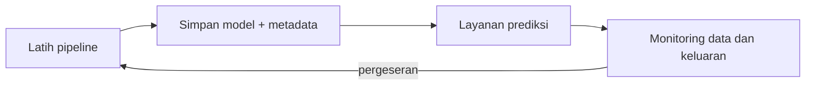

# Menyimpan Model, Deployment, dan Monitoring

## Tujuan pembelajaran

- [x] Menyimpan dan memuat `Pipeline` utuh dengan `joblib`, beserta metadata.
- [x] Memprediksi data baru dengan format kolom yang benar.
- [x] Memahami opsi deployment dan risiko keamanan berkas model.
- [x] Memantau pergeseran data (*data drift*) setelah model dipakai.

## Menyimpan model

Simpan **pipeline utuh** (praproses + model), bukan model saja, agar data baru mengalami praproses yang sama persis. Catat juga metadata: versi pustaka, daftar fitur, arti kelas, dan cara model dilatih.

!!! danger "Keamanan berkas model"
    `joblib` (dan `pickle`) dapat mengeksekusi kode saat dimuat. **Jangan memuat berkas model dari sumber yang tidak tepercaya.** Model yang disimpan dengan versi scikit-learn tertentu juga sebaiknya dimuat dengan versi yang sama; versi berbeda dapat menimbulkan galat atau hasil berbeda.

## Implementasi langkah demi langkah

Program `examples/classification/saving.py` melatih regresi logistik pada Breast Cancer lalu menyimpan, memuat, memprediksi, dan memantaunya. Bagian pemantauan memakai batch "data baru" **sintetis**: salinan data uji dengan fitur `mean radius` sengaja digeser 30% untuk mensimulasikan perubahan data. Program lengkap ada di akhir bagian ini.

### Langkah 1: menyimpan pipeline dan metadata

**Tujuan.** Menyimpan model terlatih agar dapat dipakai lagi tanpa melatih ulang, bersama catatan yang dibutuhkan untuk memakainya dengan benar.

```python title="saving.py" linenums="14"
--8<-- "classification/saving.py:14:32"
```

| Kode | Penjelasan |
|---|---|
| `Path(tempfile.mkdtemp())` | Membuat folder sementara baru dan membungkusnya sebagai `Path` agar mudah dipakai. Pada proyek nyata, gunakan folder pilihan Anda. |
| `joblib.dump(model, out_dir / "...joblib")` | **Serialisasi**: menyimpan objek `model` (seluruh pipeline: scaler + model yang sudah dilatih) ke berkas. Operator `/` pada `Path` menyambung folder dan nama berkas. |
| `meta = {...}` | Kamus metadata: versi scikit-learn saat pelatihan, daftar fitur dan urutannya, arti kelas, dan catatan pelatihan. |
| `json.dumps(meta, indent=2)` | Mengubah kamus menjadi teks JSON yang rapi; `write_text` menuliskannya ke berkas. |
| `sorted(p.name for p in out_dir.iterdir())` | Daftar nama berkas di folder, urut abjad. |

```text
--8<-- "expected/classification/saving.txt:1:1"
```

**Mengapa pipeline utuh.** Bila hanya model yang disimpan tanpa scaler, data baru tidak mengalami standardisasi yang sama dan prediksinya salah.

### Langkah 2: memuat ulang dan memverifikasi

```python title="saving.py" linenums="34"
--8<-- "classification/saving.py:34:37"
```

`joblib.load` membaca berkas dan mengembalikan objek pipeline yang siap dipakai. `np.array_equal(a, b)` memeriksa apakah dua array sama persis; di sini membandingkan prediksi model asli dan model termuat.

```text
--8<-- "expected/classification/saving.txt:2:2"
```

**Hasil.** `True`: prediksi identik. Uji sederhana ini layak dilakukan setiap kali menyimpan model.

### Langkah 3: prediksi untuk satu sampel baru

**Konsep.** Pipeline yang disimpan mengharapkan **kolom yang sama dengan data latih** (nama dan urutan). Karena itu masukan harus berupa `DataFrame`, bukan list angka.

```python title="saving.py" linenums="39"
--8<-- "classification/saving.py:39:41"
```

`X_test.iloc[[0]]` dengan **dua kurung siku** menghasilkan `DataFrame` berisi satu baris (satu kurung menghasilkan `Series` yang tidak cocok). `predict_proba(new_sample)[0]` mengambil baris pertama probabilitas: urutan kolom `[P(kelas 0 = ganas), P(kelas 1 = jinak)]`.

```text
--8<-- "expected/classification/saving.txt:3:3"
```

**Hasil.** Probabilitas ganas ≈ 1,0 dan jinak ≈ 0,0, sesuai label asli 0 (ganas).

### Langkah 4: memantau pergeseran fitur (*data drift*)

**Konsep.** Setelah model dipakai, data baru dapat berbeda dari data latih. Uji Kolmogorov–Smirnov (`ks_2samp`) membandingkan dua distribusi: **p-value kecil** berarti distribusinya berbeda secara statistik.

```python title="saving.py" linenums="43"
--8<-- "classification/saving.py:43:50"
```

`new_batch["mean radius"] * 1.3` menggeser satu fitur 30% (simulasi). Perulangan menghitung p-value KS untuk tiga fitur: `ks_2samp(X_train[col], new_batch[col]).pvalue`. Ambang 0,01 hanyalah pilihan di sini; teks `"<- bergeser"` dicetak bila p-value di bawahnya.

```text
--8<-- "expected/classification/saving.txt:5:8"
```

**Interpretasi.** `mean radius` mendapat p-value ≈ 0,0000 (jelas bergeser), sedangkan `mean texture` (0,634) dan `mean smoothness` (0,626) tidak. Uji statistik hanyalah sinyal untuk diperiksa; sampel besar dapat menandai pergeseran yang kecil secara praktis.

### Langkah 5: memantau keluaran model

```python title="saving.py" linenums="52"
--8<-- "classification/saving.py:52:55"
```

`(loaded.predict(X_test) == 0).mean()` menghitung **proporsi** sampel yang diprediksi ganas (membandingkan dengan 0 menghasilkan `True`/`False`, dan rata-ratanya adalah proporsinya).

```text
--8<-- "expected/classification/saving.txt:10:10"
```

**Interpretasi.** Porsi prediksi "ganas" naik dari 0,368 (data uji) menjadi 0,404 pada batch yang bergeser. Perubahan distribusi prediksi, bahkan tanpa label, sering menjadi tanda awal masalah.

??? example "Program lengkap (`saving.py`)"
    ```python title="saving.py" linenums="1"
    --8<-- "classification/saving.py"
    ```

## Deployment

Model dapat dipakai dalam beberapa bentuk:

| Bentuk | Cocok untuk |
|---|---|
| Skrip/notebook terjadwal (*batch*) | Prediksi berkala untuk banyak data |
| Layanan web (API) | Prediksi sesuai permintaan |
| Aplikasi interaktif sederhana | Demo dan prototipe |



Contoh berikut **hanya ilustrasi** kerangka API dengan FastAPI; tidak dijalankan atau diuji di materi ini dan membutuhkan pustaka tambahan (`fastapi`, `uvicorn`):

```python
# Ilustrasi saja (tidak diuji di materi ini)
import joblib
import pandas as pd
from fastapi import FastAPI

app = FastAPI()
model = joblib.load("breast_cancer_model.joblib")

@app.post("/predict")
def predict(features: dict):
    row = pd.DataFrame([features])                 # kolom harus sama dengan data latih
    proba_benign = float(model.predict_proba(row)[0, 1])
    return {"proba_benign": proba_benign}
```

Pada penggunaan nyata tambahkan validasi masukan, pencatatan (*logging*), versi model, dan keamanan akses.

## Monitoring dan pemeliharaan

- **Pergeseran data**: distribusi fitur berubah dari data latih.
- ***Concept drift***: hubungan fitur dengan label berubah; hanya terdeteksi bila label baru tersedia.
- Pantau metrik performa begitu label sebenarnya diketahui, simpan versi model dan data latihnya, dan tentukan kapan melatih ulang.

## Kesalahan umum

!!! warning "Hindari"
    - Menyimpan model tanpa praproses sehingga data baru tidak diproses sama.
    - Memuat berkas model dari sumber tidak tepercaya.
    - Tidak mencatat versi pustaka dan fitur.
    - Menganggap model "selesai" setelah deployment tanpa pemantauan.

## Latihan

1. Simpan model ke folder pilihan Anda, tutup Python, lalu muat dan prediksi dari proses baru.
2. Geser `mean texture` sebesar 5% dan periksa p-value KS. Kapan pergeseran mulai terdeteksi?
3. Tambahkan pemeriksaan bahwa kolom data baru sama dengan `meta["features"]` sebelum memprediksi.

## Ringkasan

Simpan pipeline utuh dengan metadata, uji muat ulang, jaga keamanan berkas model, dan pantau masukan serta keluaran setelah deployment untuk mendeteksi pergeseran.

Berikutnya: [Proyek Klasifikasi End-to-End](project.md).
