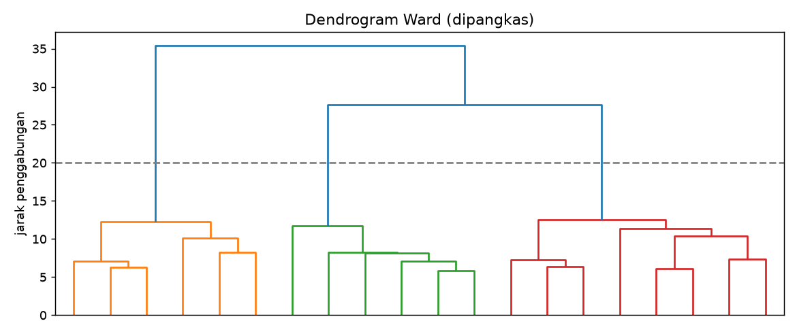

# Agglomerative Clustering

## Tujuan pembelajaran

- [x] Menjelaskan klastering hierarkis aglomeratif dan dendrogram.
- [x] Membandingkan jenis *linkage*: Ward, complete, average, single.
- [x] Menentukan jumlah klaster dari dendrogram dan ambang jarak.

## Intuisi

Klastering aglomeratif bekerja **dari bawah ke atas**: awalnya tiap titik adalah satu klaster, lalu dua klaster terdekat digabung berulang sampai tersisa satu. Riwayat penggabungan digambar sebagai **dendrogram**; memotongnya pada ketinggian tertentu menghasilkan jumlah klaster tertentu.

Jarak antar-klaster ditentukan oleh ***linkage***:

| Linkage | Jarak antar-klaster | Kecenderungan |
|---|---|---|
| Ward | Penambahan variasi dalam klaster akibat penggabungan | Klaster kompak dan berukuran mirip (mirip k-Means) |
| Complete | Jarak terjauh antar-anggota | Klaster kompak |
| Average | Rata-rata seluruh pasangan | Kompromi |
| Single | Jarak terdekat antar-anggota | Rantai panjang, mudah menggabungkan *outlier* |

| Aspek | Keterangan |
|---|---|
| Kelebihan | Tidak perlu menentukan \(k\) di awal; dendrogram memberi gambaran hierarki; deterministik |
| Keterbatasan | Biaya memori dan waktu naik cepat pada data besar; keputusan penggabungan tidak dapat dibatalkan |
| Hyperparameter penting | `linkage`, `n_clusters` atau `distance_threshold`, `metric` |
| Praproses | *Scaling* wajib |

## Implementasi langkah demi langkah

Wine terstandardisasi. Program `examples/clustering/agglomerative.py`; program lengkap ada di akhir bagian ini.

### Langkah 1: membandingkan jenis *linkage*

**Tujuan.** Melihat bahwa pilihan *linkage* sangat menentukan hasil.

```python title="agglomerative.py" linenums="14"
--8<-- "clustering/agglomerative.py:14:21"
```

| Kode | Penjelasan |
|---|---|
| `Z = StandardScaler().fit_transform(X)` | Standardisasi (jarak digunakan, sehingga wajib). |
| `AgglomerativeClustering(n_clusters=3, linkage=method)` | Klastering aglomeratif yang berhenti pada 3 klaster; `linkage` menentukan cara jarak antar-klaster dihitung. |
| `.fit_predict(Z)` | Mengelompokkan dan mengembalikan label tiap sampel. |
| `np.bincount(labels).tolist()` | Ukuran tiap klaster. |

```text
--8<-- "expected/clustering/agglomerative.txt:1:5"
```

**Interpretasi.** Ward: ARI 0,790 dan silhouette 0,277 dengan klaster seimbang (58, 56, 64). Complete: ARI 0,577. **Average dan single gagal**: satu klaster menampung 174 dari 178 titik dan dua klaster lain hanya berisi 1 sampai 3 titik (ARI ≈ 0), efek rantai dari beberapa titik terpencil. Untuk data ini Ward paling cocok, sama seperti sifat k-Means.

### Langkah 2: matriks linkage dan lonjakan jarak penggabungan

**Konsep.** SciPy menyimpan riwayat penggabungan dalam *matriks linkage*: tiap baris adalah satu penggabungan, dan kolom ketiga adalah **jarak penggabungannya**. Lonjakan besar pada jarak berarti dua klaster yang digabung sebenarnya berjauhan.

```python title="agglomerative.py" linenums="23"
--8<-- "clustering/agglomerative.py:23:27"
```

`linkage(Z, method="ward")` menghitung seluruh riwayat penggabungan. `L[-8:, 2]` mengambil kolom jarak dari 8 baris terakhir (penggabungan terakhir). `np.diff(...)` menghitung selisih antar-nilai berurutan.

```text
--8<-- "expected/clustering/agglomerative.txt:7:8"
```

**Interpretasi.** Jarak penggabungan Ward untuk 8 penggabungan terakhir: 10,2; 10,4; 11,4; 11,7; 12,2; 12,6; **27,7**; 35,4. Ada lonjakan besar (selisih 15,1) sebelum dua penggabungan terakhir: menggabungkan klaster yang jauh menunjukkan struktur alami sekitar **tiga klaster**, yaitu pemotongan sebelum lonjakan.

### Langkah 3: memotong dengan ambang jarak

```python title="agglomerative.py" linenums="29"
--8<-- "clustering/agglomerative.py:29:31"
```

`n_clusters=None` dengan `distance_threshold=20` meminta algoritma berhenti menggabung ketika jarak penggabungan berikutnya melebihi 20, sehingga jumlah klaster ditentukan oleh data, bukan oleh kita. `labels_thr.max() + 1` menghitung jumlah klaster dari label tertinggi.

```text
--8<-- "expected/clustering/agglomerative.txt:9:9"
```

**Hasil.** Ambang jarak 20 menghasilkan tepat 3 klaster, sesuai lonjakan pada langkah sebelumnya.

### Langkah 4: dendrogram

```python title="agglomerative.py" linenums="33"
--8<-- "clustering/agglomerative.py:33:40"
```

`dendrogram(L, truncate_mode="lastp", p=20)` menggambar pohon penggabungan, dipangkas pada 20 penggabungan terakhir agar terbaca; `color_threshold=20` mewarnai cabang di bawah ambang; garis putus-putus `axhline(20)` menandai pemotongan.



**Cara membaca.** Sumbu-y adalah jarak penggabungan; sumbu-x berisi klaster hasil pemangkasan. Makin tinggi sebuah penggabungan, makin berjauhan klaster yang digabung. Garis di tinggi 20 memotong tiga cabang: tiga klaster. Perbandingan dengan k-Means: Ward (ARI 0,790) lebih rendah daripada k-Means (0,897) pada data yang sama; keduanya mirip, tetapi tidak identik.

??? example "Program lengkap (`agglomerative.py`)"
    ```python title="agglomerative.py" linenums="1"
    --8<-- "clustering/agglomerative.py"
    ```

## Kesalahan umum

!!! warning "Hindari"
    - Memakai `single` linkage tanpa memeriksa efek rantai.
    - Memotong dendrogram tanpa melihat lonjakan jarak.
    - Memakai agglomerative pada data besar (ribuan hingga jutaan titik) tanpa mempertimbangkan biaya.
    - Memakai Ward dengan jarak selain Euclidean (Ward mensyaratkan Euclidean).

## Latihan

1. Coba `metric="manhattan"` dengan `linkage="average"`.
2. Tentukan ambang jarak yang menghasilkan 4 klaster.
3. Hitung *cophenetic correlation* (`scipy.cluster.hierarchy.cophenet`) untuk tiap linkage.

## Ringkasan

Klastering aglomeratif menggabungkan klaster terdekat secara bertahap dan memberi dendrogram. Pilihan *linkage* sangat menentukan; Ward bekerja baik untuk klaster kompak, sedangkan `single` rentan terhadap efek rantai.

Berikutnya: [Memilih Jumlah Klaster dan Validasi](choose-k-validation.md).
