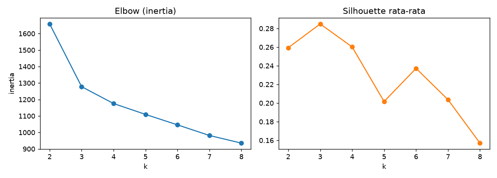

# Memilih Jumlah Klaster dan Validasi

## Tujuan pembelajaran

- [x] Memakai *elbow*, silhouette, Davies-Bouldin, dan Calinski-Harabasz untuk memilih \(k\).
- [x] Menilai kestabilan klaster dengan bootstrap.
- [x] Membedakan validasi internal dan eksternal serta batasan masing-masing.

## Metrik internal

Metrik internal menilai klaster tanpa label, dari kepadatan dan keterpisahan:

| Metrik | Arah terbaik | Arti |
|---|---|---|
| *Inertia* (jumlah kuadrat dalam klaster) | Turun terus saat \(k\) naik; cari "siku" | Kekompakan; selalu membaik bila \(k\) ditambah |
| Silhouette | Maksimum (rentang -1 sampai 1) | Seberapa dekat titik ke klasternya dibanding klaster terdekat lain |
| Davies-Bouldin | Minimum | Rasio sebaran dalam klaster terhadap jarak antar-klaster |
| Calinski-Harabasz | Maksimum | Rasio variasi antar-klaster terhadap dalam-klaster |

Untuk satu titik \(i\) dengan jarak rata-rata ke klasternya \(a_i\) dan jarak rata-rata ke klaster terdekat lainnya \(b_i\):

$$
s_i = \frac{b_i - a_i}{\max(a_i, b_i)}
$$

Silhouette klaster atau keseluruhan adalah rata-rata \(s_i\). Nilai dekat 1 berarti klaster jelas; dekat 0 berarti tumpang tindih; negatif berarti titik mungkin salah klaster.

## Validasi eksternal dan kestabilan

- **Validasi eksternal** membandingkan klaster dengan label acuan yang diketahui: *Adjusted Rand Index* (ARI; 1 = identik, ≈ 0 = acak) dan *Normalized Mutual Information* (NMI). Hanya mungkin bila ada label acuan, dan label itu pun belum tentu "kebenaran".
- **Kestabilan**: klasterkan sampel bootstrap lalu bandingkan dengan klaster data penuh (ARI pada titik yang terambil). Klaster yang stabil muncul kembali pada sampel berbeda.

## Implementasi langkah demi langkah

Wine terstandardisasi, k-Means dengan \(k = 2, \dots, 8\). Kolom `ARI_vs_kultivar` hanya tersedia karena Wine punya label; pada masalah nyata kolom ini tidak ada. Program `examples/clustering/choose_k.py`; program lengkap ada di akhir bagian ini.

### Langkah 1: metrik internal untuk setiap \(k\)

**Tujuan.** Mengumpulkan beberapa ukuran kualitas untuk tiap jumlah klaster, tanpa memakai label.

```python title="choose_k.py" linenums="20"
--8<-- "clustering/choose_k.py:20:35"
```

| Kode | Penjelasan |
|---|---|
| `for k in range(2, 9)` | Mencoba \(k = 2, 3, \dots, 8\) (`range(2, 9)` berhenti sebelum 9). |
| `KMeans(n_clusters=k, ...).fit(Z)` | Melatih k-Means untuk tiap `k`. |
| `km.inertia_` | Jumlah kuadrat jarak ke pusat (selalu turun saat `k` naik). |
| `silhouette_score(Z, km.labels_)` | Rata-rata silhouette (makin besar makin baik). |
| `davies_bouldin_score`, `calinski_harabasz_score` | Davies-Bouldin (makin kecil makin baik) dan Calinski-Harabasz (makin besar makin baik). |
| `adjusted_rand_score(y, km.labels_)` | Validasi eksternal terhadap kultivar (hanya karena label ada). |
| `table["silhouette"].idxmax()` | **Nilai indeks** (`k`) dengan silhouette tertinggi. |

```text
--8<-- "expected/clustering/choose_k.txt:1:11"
```

**Interpretasi.** **Tiga metrik internal sepakat pada \(k=3\)**: silhouette tertinggi (0,285), Davies-Bouldin terendah (1,389), dan Calinski-Harabasz tertinggi (70,9). Tidak selalu sesepakat ini. Silhouette 0,285 tergolong rendah: ada struktur, tetapi klaster saling berdekatan (pedoman umum: > 0,5 kuat, 0,25–0,5 lemah; ini *rule of thumb*, bukan standar). Validasi eksternal: ARI tertinggi pada \(k=3\) (0,897); pada \(k=2\) turun ke 0,374 karena dua kultivar digabung.

### Langkah 2: metode siku (*elbow*)

```python title="choose_k.py" linenums="37"
--8<-- "clustering/choose_k.py:37:39"
```

`table["inertia"].diff()` menghitung selisih inertia tiap `k` dengan `k` sebelumnya (negatif karena inertia turun); dengan tanda minus dan pembagian terhadap inertia `k-1`, hasilnya persentase penurunan.

```text
--8<-- "expected/clustering/choose_k.txt:12:12"
```

**Interpretasi.** Inertia turun 23,0% dari \(k=2\) ke \(k=3\), tetapi hanya 8,0% (\(k=4\)), 5,6% (\(k=5\)), dan seterusnya sekitar 5%: siku jelas di \(k=3\). Pada banyak data siku tidak setegas ini dan sulit ditentukan.

### Langkah 3: kestabilan dengan bootstrap

**Konsep.** Klaster yang nyata seharusnya muncul kembali pada sampel data yang sedikit berbeda. Kita mengambil sampel *bootstrap* (pengambilan acak **dengan pengembalian**), mengklasterkannya, dan membandingkan dengan klaster data penuh pada titik-titik yang sama.

```python title="choose_k.py" linenums="41"
--8<-- "clustering/choose_k.py:41:51"
```

| Kode | Penjelasan |
|---|---|
| `rng.integers(0, len(Z), len(Z))` | Nomor baris acak sebanyak data (boleh berulang) = sampel bootstrap. |
| `np.unique(...)` | Baris yang terambil, tanpa duplikat. |
| `KMeans(...).fit_predict(Z[idx])` | Klastering sampel bootstrap dengan seed acak berbeda. |
| `adjusted_rand_score(full[idx], boot)` | Kecocokan klaster bootstrap dengan klaster data penuh pada titik-titik terambil. |
| `np.mean(aris)` | Rata-rata ARI atas 30 bootstrap = skor kestabilan. |

```text
--8<-- "expected/clustering/choose_k.txt:14:19"
```

**Interpretasi.** \(k=3\) sangat stabil (ARI 0,961) sedangkan \(k=2\) (0,675), \(k=4\) (0,781), \(k=5\) (0,631), dan \(k=6\) (0,661) kurang stabil. Kestabilan memberi bukti tambahan yang tidak bergantung pada label.

### Langkah 4: gambar elbow dan silhouette

```python title="choose_k.py" linenums="53"
--8<-- "clustering/choose_k.py:53:60"
```



**Cara membaca.** Sumbu-x adalah jumlah klaster \(k\). Grafik kiri (inertia) selalu menurun; cari titik tempat penurunan melandai (siku), di sini sekitar \(k=3\). Grafik kanan (silhouette) mencapai puncak pada \(k=3\). Kesepakatan ini tidak menjamin metrik internal selalu menemukan \(k\) yang bermakna (lihat [pembahasan perbandingan](comparison-tuning.md)); gabungkan beberapa bukti dan kebutuhan bisnis.

??? example "Program lengkap (`choose_k.py`)"
    ```python title="choose_k.py" linenums="1"
    --8<-- "clustering/choose_k.py"
    ```

## Kesalahan umum

!!! warning "Hindari"
    - Memilih \(k\) hanya dari inertia (selalu turun).
    - Mempercayai satu metrik internal saja.
    - Memakai ARI sebagai ukuran akurasi seolah label acuan pasti benar.
    - Melaporkan \(k\) tanpa kestabilannya.
    - Mengabaikan kegunaan praktis: 3 vs 4 segmen mungkin lebih berguna bagi bisnis meski metriknya sedikit lebih rendah.

## Latihan

1. Ulangi dengan `AgglomerativeClustering` (Ward) pada \(k = 2..8\). Apakah \(k\) terbaiknya sama?
2. Naikkan jumlah bootstrap menjadi 100. Apakah urutan kestabilan berubah?
3. Hitung silhouette per klaster untuk \(k=3\) (`silhouette_samples`). Klaster mana yang paling longgar?

## Ringkasan

Pilih \(k\) dengan gabungan elbow, silhouette, Davies-Bouldin, dan Calinski-Harabasz, ditambah kestabilan dan kegunaan. Validasi eksternal berguna jika ada label acuan, tetapi bukan pengganti penilaian internal.

Berikutnya: [Perbandingan Algoritma dan Optimasi Parameter](comparison-tuning.md).
