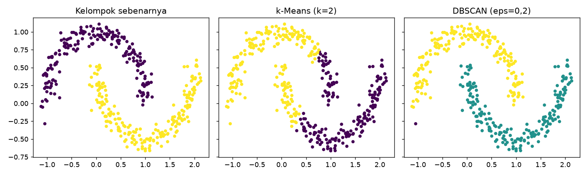

# DBSCAN

## Tujuan pembelajaran

- [x] Menjelaskan klastering berbasis kepadatan: titik inti, titik batas, dan *noise*.
- [x] Memilih `eps` dan `min_samples` dengan bantuan jarak ke tetangga.
- [x] Mengenali kapan DBSCAN unggul dan kapan sulit digunakan.

## Intuisi

DBSCAN (*Density-Based Spatial Clustering of Applications with Noise*) mendefinisikan klaster sebagai daerah yang **padat**, dipisahkan daerah yang jarang. Dua parameter:

- `eps` (\(\varepsilon\)): radius lingkungan sebuah titik.
- `min_samples`: jumlah minimum titik (termasuk dirinya) di dalam radius agar titik menjadi **titik inti** (*core point*).

Titik inti yang saling terjangkau membentuk satu klaster; **titik batas** berada di lingkungan titik inti tetapi bukan titik inti; sisanya adalah ***noise*** (label `-1`). Tidak perlu menentukan jumlah klaster, klaster dapat berbentuk bebas, dan *outlier* otomatis ditandai.

| Aspek | Keterangan |
|---|---|
| Kelebihan | Bentuk klaster bebas, mendeteksi *noise*, tanpa menentukan \(k\) |
| Keterbatasan | Sensitif pada `eps`; sulit bila kepadatan antar-klaster berbeda; kurang efektif pada dimensi tinggi |
| Hyperparameter penting | `eps`, `min_samples`, `metric` |
| Praproses | *Scaling* wajib |

**Memilih `eps`**: hitung jarak tiap titik ke tetangga ke-`min_samples`, urutkan, lalu cari "siku" (lonjakan). Nilai `eps` di sekitar siku memisahkan titik padat dari titik terpencil.

## Implementasi langkah demi langkah

Bulan sabit **sintetis** (400 titik, derau kecil) untuk memperlihatkan keunggulan DBSCAN, lalu Wine (13 dimensi) untuk memperlihatkan kesulitannya. Program `examples/clustering/dbscan.py`; program lengkap ada di akhir bagian ini.

### Langkah 1: data dan fungsi ringkasan

```python title="dbscan.py" linenums="14"
--8<-- "clustering/dbscan.py:14:21"
```

`make_moons(...)` membuat dua bulan sabit; `y` adalah kelompok sebenarnya (hanya untuk ARI). Fungsi `summarize(labels)` menghitung jumlah klaster dan persentase *noise*. DBSCAN memberi label **-1** pada titik *noise*, sehingga `set(labels) - {-1}` adalah himpunan klaster nyata (tanpa -1), dan `np.mean(labels == -1)` adalah proporsi titik *noise*.

### Langkah 2: pengaruh `eps`

**Konsep.** `eps` adalah radius lingkungan. Terlalu kecil → hampir semua titik menjadi *noise* dan klaster pecah; terlalu besar → semuanya menyatu menjadi satu klaster.

```python title="dbscan.py" linenums="24"
--8<-- "clustering/dbscan.py:24:29"
```

`DBSCAN(eps=eps, min_samples=5).fit_predict(X)` mengelompokkan data dan mengembalikan label (−1 = *noise*). `min_samples=5` berarti sebuah titik inti harus memiliki minimal 5 titik (termasuk dirinya) dalam radius `eps`.

```text
--8<-- "expected/clustering/dbscan.txt:1:7"
```

**Interpretasi.** `eps=0,05` membuat 15 klaster dengan 77,5% *noise* (terlalu kecil); `eps=0,1` menghasilkan 11 klaster (ARI 0,236); **`eps=0,2`** menemukan 2 klaster dengan hanya 0,2% *noise* (ARI **0,995**); `eps≥0,3` menggabungkan semuanya menjadi 1 klaster (ARI 0).

### Langkah 3: memilih `eps` dari jarak ke tetangga

```python title="dbscan.py" linenums="31"
--8<-- "clustering/dbscan.py:31:35"
```

| Kode | Penjelasan |
|---|---|
| `NearestNeighbors(n_neighbors=k).fit(X).kneighbors(X)` | Untuk tiap titik, mencari `k` tetangga terdekat dan jaraknya. |
| `dist[:, -1]` | Kolom terakhir: jarak ke tetangga ke-`k` (yang paling jauh di antara `k` tetangga). |
| `np.sort(...)`, `np.percentile(kdist, [50, 90, 95, 99])` | Jarak diurutkan; persentil menunjukkan seberapa cepat jarak melonjak. |

```text
--8<-- "expected/clustering/dbscan.txt:9:9"
```

**Interpretasi.** Jarak ke tetangga ke-5 pada persentil 50/90/95/99 adalah 0,078; 0,115; 0,139; 0,200. Nilai `eps=0,2` (persentil 99) berhasil di sini; aturan ini hanya panduan, bukan rumus pasti.

### Langkah 4: perbandingan dengan k-Means

```python title="dbscan.py" linenums="37"
--8<-- "clustering/dbscan.py:37:42"
```

```text
--8<-- "expected/clustering/dbscan.txt:11:12"
```

**Hasil.** Pada bulan sabit DBSCAN ARI 0,995 vs k-Means 0,233. DBSCAN menandai 1 titik sebagai *noise*.

### Langkah 5: DBSCAN pada data berdimensi tinggi (Wine)

```python title="dbscan.py" linenums="44"
--8<-- "clustering/dbscan.py:44:52"
```

Wine distandardisasi (13 fitur) lalu DBSCAN dicoba dengan lima nilai `eps`; label kultivar `yw` hanya untuk ARI.

```text
--8<-- "expected/clustering/dbscan.txt:14:20"
```

**Interpretasi.** `eps=1,5` menandai seluruh data sebagai *noise*; `eps=2,0` menghasilkan 5 klaster dengan 47,8% *noise* (ARI 0,220); `eps≥2,5` menghasilkan 1 klaster (ARI ≈ 0). Pada dimensi tinggi, jarak antar-titik cenderung seragam sehingga kepadatan sulit dibedakan; DBSCAN tidak menemukan tiga kultivar, padahal k-Means menemukannya (ARI 0,897). **Tidak ada algoritma yang unggul di semua data.**

### Langkah 6: gambar

```python title="dbscan.py" linenums="54"
--8<-- "clustering/dbscan.py:54:62"
```

Tiga grafik berdampingan memakai sumbu yang sama (`sharex`, `sharey`): kelompok sebenarnya, hasil k-Means, dan hasil DBSCAN; warna menunjukkan label klaster.



**Cara membaca.** Sumbu-x dan sumbu-y adalah dua fitur sintetis. Panel kiri menunjukkan dua bulan sabit sebenarnya; k-Means (tengah) memotongnya dengan batas lurus sehingga kedua bulan tercampur (ARI hanya 0,233); DBSCAN (kanan) mengikuti bentuk melengkung dan memisahkan kedua bulan dengan benar.

??? example "Program lengkap (`dbscan.py`)"
    ```python title="dbscan.py" linenums="1"
    --8<-- "clustering/dbscan.py"
    ```

## Kesalahan umum

!!! warning "Hindari"
    - Memakai `eps` tanpa *scaling* dan tanpa melihat jarak ke tetangga.
    - Menganggap hasil dengan banyak *noise* atau satu klaster sebagai "tidak ada struktur".
    - Memakai DBSCAN pada data berdimensi tinggi tanpa reduksi dimensi.
    - Mengharapkan DBSCAN menangani klaster dengan kepadatan berbeda jauh.

## Latihan

1. Naikkan `min_samples` menjadi 10 dan 20 pada bulan sabit. Bagaimana `eps` terbaik bergeser?
2. Tambahkan derau (`noise=0.2`) pada `make_moons`. Apakah DBSCAN masih unggul?
3. Terapkan PCA ke 3 komponen pada Wine sebelum DBSCAN dan coba lagi.

## Ringkasan

DBSCAN menemukan klaster padat berbentuk bebas dan menandai *noise*, tanpa menentukan jumlah klaster. Parameter `eps` krusial dan sulit pada dimensi tinggi.

Berikutnya: [Agglomerative Clustering](agglomerative.md).
