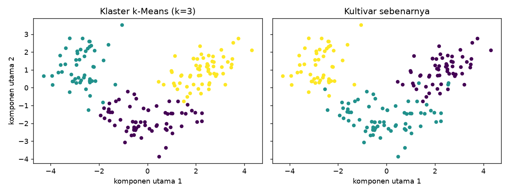

# k-Means

## Tujuan pembelajaran

- [x] Menjelaskan algoritma k-Means dan fungsi tujuannya (inertia).
- [x] Menafsirkan pusat klaster dalam satuan asli.
- [x] Memahami sensitivitas terhadap inisialisasi dan asumsi bentuk klaster.

## Intuisi

k-Means membagi data menjadi \(k\) klaster dengan **pusat (centroid)** masing-masing. Algoritma (Lloyd) mengulang dua langkah sampai tidak berubah:

1. **Tetapkan**: tiap titik masuk ke klaster dengan pusat terdekat.
2. **Perbarui**: pusat tiap klaster dihitung ulang sebagai **rata-rata** anggotanya.

Tujuannya meminimalkan *inertia* (jumlah kuadrat jarak titik ke pusat klasternya):

$$
J = \sum_{c=1}^{k} \sum_{\mathbf{x}_i \in C_c} \lVert \mathbf{x}_i - \mathbf{\mu}_c \rVert^2
$$

\(C_c\) anggota klaster \(c\) dan \(\mathbf{\mu}_c\) pusatnya. Algoritma hanya menjamin optimum **lokal**, sehingga hasil bergantung pada titik awal. `k-means++` memilih pusat awal yang tersebar, dan `n_init` mengulang beberapa kali lalu mengambil inertia terkecil.

| Aspek | Keterangan |
|---|---|
| Kelebihan | Cepat, sederhana, skalabel, mudah ditafsirkan lewat pusat |
| Keterbatasan | Harus menentukan \(k\); mengasumsikan klaster bulat dan berukuran mirip; sensitif pada *outlier* dan skala |
| Hyperparameter penting | `n_clusters`, `n_init`, `init` |
| Praproses | *Scaling* wajib |

## Implementasi langkah demi langkah

Wine terstandardisasi (k=3), lalu uji inisialisasi dan data bulan sabit **sintetis** untuk memperlihatkan keterbatasan. Program `examples/clustering/kmeans.py`; program lengkap ada di akhir bagian ini.

### Langkah 1: standardisasi dan k-Means

**Tujuan.** Mengelompokkan 178 anggur menjadi 3 klaster tanpa memakai label.

```python title="kmeans.py" linenums="16"
--8<-- "clustering/kmeans.py:16:23"
```

| Kode | Penjelasan |
|---|---|
| `scaler = StandardScaler().fit(X)`; `Z = scaler.transform(X)` | Standardisasi seluruh fitur. Pada klastering semua data dipakai (tidak ada pembagian latih/uji), sehingga scaler cukup dipelajari dari data yang sama; objek `scaler` disimpan agar pusat klaster nanti dapat dikembalikan ke satuan asli. |
| `KMeans(n_clusters=3, init="k-means++", n_init=10, random_state=SEED)` | 3 klaster; `init="k-means++"` memilih pusat awal yang tersebar; `n_init=10` mengulang seluruh algoritma 10 kali dari titik awal berbeda dan mengambil hasil dengan inertia terkecil. |
| `.fit(Z)` | Menjalankan algoritma. Hanya **fitur** `Z` yang diberikan; **tidak ada `y`**. |
| `km.labels_` | Nomor klaster (0, 1, 2) tiap sampel. |
| `np.bincount(km.labels_)` | Jumlah anggota tiap klaster. |
| `km.inertia_` | Jumlah kuadrat jarak titik ke pusat klasternya. |

```text
--8<-- "expected/clustering/kmeans.txt:1:2"
```

**Hasil.** Tiga klaster berukuran 65, 51, 62 dengan inertia 1277,9. ARI terhadap kultivar 0,897: pengelompokan hampir identik dengan kultivar yang tidak pernah dilihat algoritma.

### Langkah 2: pusat klaster dalam satuan asli

```python title="kmeans.py" linenums="25"
--8<-- "clustering/kmeans.py:25:27"
```

`km.cluster_centers_` berada pada skala terstandardisasi sehingga sulit dibaca. `scaler.inverse_transform(...)` mengembalikannya ke satuan asli, lalu `DataFrame(..., columns=X.columns)` memberi nama kolom.

```text
--8<-- "expected/clustering/kmeans.txt:4:8"
```

**Interpretasi.** Klaster 2 beralkohol tinggi (13,68), berflavanoid tinggi (3,00), dan berprolin tinggi (1100); klaster 1 berflavanoid rendah (0,82); klaster 0 beralkohol rendah (12,25) dan berprolin rendah (510). Pusat dalam satuan asli memberi profil yang mudah dibaca.

### Langkah 3: memeriksa sifat algoritma

```python title="kmeans.py" linenums="29"
--8<-- "clustering/kmeans.py:29:31"
```

`Z[km.labels_ == k].mean(axis=0)` mengambil semua sampel di klaster `k` (syarat boolean pada baris) lalu merata-ratakannya per fitur (`axis=0`). Hasilnya dibandingkan dengan `km.cluster_centers_`.

```text
--8<-- "expected/clustering/kmeans.txt:10:10"
```

**Hasil.** Selisih maksimum 7×10⁻¹⁶ (nol akibat pembulatan): pusat klaster memang sama dengan rata-rata anggotanya, sesuai definisi algoritma.

### Langkah 4: sensitivitas terhadap inisialisasi

**Konsep.** k-Means hanya menjamin optimum **lokal**; titik awal yang berbeda dapat memberi hasil berbeda. `n_init=1` dan `init="random"` memperlihatkan efek ini.

```python title="kmeans.py" linenums="33"
--8<-- "clustering/kmeans.py:33:37"
```

Perulangan menjalankan k-Means satu kali per `seed` dengan pusat awal acak.

```text
--8<-- "expected/clustering/kmeans.txt:12:17"
```

**Interpretasi.** Tiga seed (1, 2, 3) menghasilkan inertia terbaik 1277,9 (ARI 0,897), tetapi seed 0 menghasilkan 1280,0 (ARI 0,880) dan seed 4 menghasilkan 1282,5 (ARI 0,846): optimum lokal yang lebih buruk. Karena itu `n_init=10` (bawaan) dan `k-means++` dipakai.

### Langkah 5: keterbatasan pada klaster non-bulat

```python title="kmeans.py" linenums="39"
--8<-- "clustering/kmeans.py:39:42"
```

`make_moons(n_samples=400, noise=0.08, ...)` membuat data **sintetis** berupa dua bulan sabit yang saling mengait; `ym` adalah kelompok sebenarnya. k-Means dengan 2 klaster dijalankan pada data ini.

```text
--8<-- "expected/clustering/kmeans.txt:19:19"
```

**Interpretasi.** ARI hanya 0,233: k-Means memotong ruang dengan batas lurus dan mengasumsikan klaster bulat, padahal bentuk data melengkung. Algoritma berbasis kepadatan seperti [DBSCAN](dbscan.md) cocok untuk bentuk seperti ini.

### Langkah 6: gambar

```python title="kmeans.py" linenums="44"
--8<-- "clustering/kmeans.py:44:53"
```

Data Wine memiliki 13 dimensi sehingga tidak dapat digambar langsung. `PCA(n_components=2)` memproyeksikannya ke **dua komponen utama** (arah dengan variasi terbesar) hanya untuk visualisasi; klastering tetap dilakukan pada 13 fitur. Dua grafik berdampingan diwarnai menurut klaster k-Means dan menurut kultivar sebenarnya.



**Cara membaca.** Sumbu-x dan sumbu-y adalah komponen utama 1 dan 2 (tidak punya satuan alami); tiap titik satu anggur dan warna menunjukkan kelompok. Pola warna di kiri sangat mirip dengan kanan, konsisten dengan ARI 0,897. Tumpang-tindih di perbatasan menjelaskan mengapa ARI tidak 1.

??? example "Program lengkap (`kmeans.py`)"
    ```python title="kmeans.py" linenums="1"
    --8<-- "clustering/kmeans.py"
    ```

## Kesalahan umum

!!! warning "Hindari"
    - Memakai k-Means tanpa *scaling*.
    - Satu kali inisialisasi (`n_init=1`) lalu menerima hasilnya.
    - Menganggap k-Means selalu menemukan klaster "sebenarnya".
    - Memakai k-Means pada klaster non-bulat atau data dengan banyak *outlier*.
    - Memilih \(k\) sembarang ([lesson berikutnya](choose-k-validation.md)).

## Latihan

1. Jalankan dengan `k=2` dan `k=5`. Bagaimana inertia dan ukuran klaster?
2. Bandingkan `init="random"` dan `"k-means++"` dengan `n_init=1` pada 20 seed.
3. Coba `MiniBatchKMeans` dan bandingkan hasil dan kecepatannya.

## Ringkasan

k-Means mengalternasi penetapan dan pembaruan pusat untuk meminimalkan inertia. Wajib *scaling*, gunakan `n_init` yang cukup, dan ingat asumsi klaster bulat.

Berikutnya: [DBSCAN](dbscan.md).
