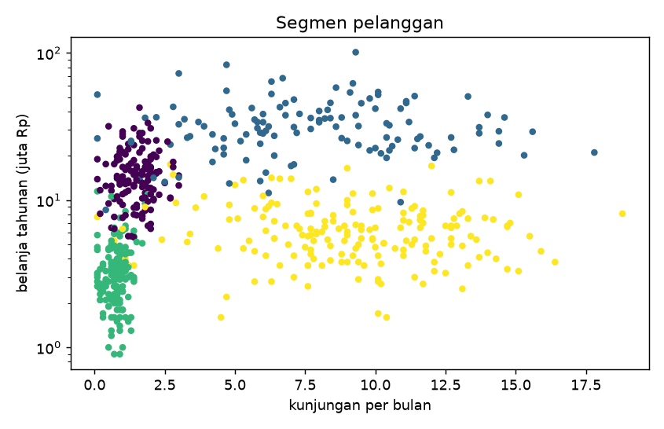

# Profil dan Interpretasi Klaster

## Tujuan pembelajaran

- [x] Membangun pipeline klastering (transformasi log, *scaling*, k-Means).
- [x] Membuat profil klaster dalam satuan asli dan indeks terhadap rata-rata.
- [x] Menamai segmen secara bermakna dan memeriksa kecocokannya.

## Mengapa profil?

Klaster hanya berupa nomor. Nilainya baru muncul setelah **ditafsirkan**: apa yang membedakan satu klaster dari yang lain, dalam satuan yang dimengerti pemangku kepentingan. Alur: klasterkan pada data terskala, lalu **profilkan pada satuan asli**.

## Implementasi langkah demi langkah

Data pelanggan **sintetis** ([penjelasan](concepts-data.md)): 600 pelanggan, lima fitur. `annual_spend` dan `recency_days` miring ke kanan sehingga diberi transformasi `log1p` sebelum standardisasi. Penamaan segmen di bawah memakai aturan dari profil; nama akhir selalu keputusan manusia. Program `examples/clustering/profiling.py`; program lengkap ada di akhir bagian ini.

### Langkah 1: pipeline klastering

**Tujuan.** Menggabungkan transformasi log, standardisasi, dan k-Means dalam satu `Pipeline`.

```python title="profiling.py" linenums="18"
--8<-- "clustering/profiling.py:18:33"
```

| Kode | Penjelasan |
|---|---|
| `skewed = ["annual_spend", "recency_days"]` | Fitur miring ke kanan yang perlu log. |
| `ColumnTransformer([("log", FunctionTransformer(np.log1p), skewed)], remainder="passthrough")` | Menerapkan `np.log1p` hanya pada kolom `skewed`; `remainder="passthrough"` meneruskan kolom lain apa adanya. (Urutan kolom keluaran: kolom log dulu, lalu sisanya.) |
| `Pipeline([("prep", prep), ("scale", StandardScaler()), ("km", KMeans(...))])` | Tiga langkah berurutan; langkah terakhir adalah model. |
| `pipe.fit(df[features])` | Melatih seluruh pipeline; **tanpa `y`**. |
| `pipe.named_steps["km"].labels_` | Label klaster hasil k-Means (ambil langkah `km` menurut namanya). |
| `pipe[:-1].transform(df[features])` | Menerapkan semua langkah **kecuali yang terakhir** (`[:-1]`), menghasilkan data terskala untuk menghitung silhouette. |

```text
--8<-- "expected/clustering/profiling.txt:1:1"
```

**Hasil.** Silhouette 0,428 dan ARI terhadap kelompok sebenarnya 0,927 (hanya dapat dihitung karena data sintetis).

### Langkah 2: profil dalam satuan asli

**Konsep.** Klaster hanya berupa nomor. Nilainya muncul setelah **ditafsirkan**: klasterkan pada data terskala, lalu **profilkan pada satuan asli** agar dapat dimengerti pemangku kepentingan.

```python title="profiling.py" linenums="35"
--8<-- "clustering/profiling.py:35:40"
```

| Kode | Penjelasan |
|---|---|
| `df["cluster"] = labels` | Menambahkan nomor klaster sebagai kolom di tabel asli (satuan asli). |
| `df.groupby("cluster")[features].mean()` | Rata-rata tiap fitur per klaster. |
| `profile.insert(0, "n", ...)` | Menambahkan kolom jumlah anggota (`size`) sebagai kolom pertama; `insert(1, "n%", ...)` menambahkan persentasenya. |

```text
--8<-- "expected/clustering/profiling.txt:3:9"
```

### Langkah 3: indeks terhadap rata-rata keseluruhan

```python title="profiling.py" linenums="42"
--8<-- "clustering/profiling.py:42:44"
```

`profile[features] / df[features].mean() * 100` membagi rata-rata tiap klaster dengan rata-rata seluruh pelanggan: **100 = sama dengan rata-rata keseluruhan**, 200 = dua kali lipat, 50 = setengah. Indeks memudahkan melihat ciri khas klaster tanpa terkecoh perbedaan satuan.

```text
--8<-- "expected/clustering/profiling.txt:11:17"
```

**Interpretasi** (profil dan indeks bersama):

| Klaster | Ukuran | Belanja/tahun | Kunjungan/bulan | Keranjang | Recency | Ciri utama |
|---|---|---|---|---|---|---|
| 1 | 123 (20%) | 33,0 juta (indeks 248) | 7,6 (155) | 246 rb (119) | 9,8 hari (12) | Belanja sangat besar, sering, baru saja berbelanja |
| 3 | 184 (31%) | 6,6 juta (50) | 9,1 (186) | 88 rb (43) | 14,0 hari (18) | Sangat sering datang, keranjang kecil, usia muda (25) |
| 0 | 141 (24%) | 15,4 juta (116) | 1,5 (31) | 428 rb (207) | 70,5 hari (89) | Jarang datang, keranjang besar, usia lebih tua (46) |
| 2 | 152 (25%) | 3,5 juta (26) | 0,8 (16) | 114 rb (55) | 220,7 hari (280) | Belanja dan kunjungan rendah, lama tidak kembali |

### Langkah 4: memberi nama segmen

```python title="profiling.py" linenums="46"
--8<-- "clustering/profiling.py:46:53"
```

Penamaan berbasis aturan: klaster dengan `recency_days` terbesar dinamai "tidak aktif"; dari sisanya, `annual_spend` terbesar = "loyal"; lalu `visits_per_month` terbesar = "pemburu diskon"; sisanya "musiman". `idxmax()` memberi nomor klaster dengan nilai terbesar, dan `remaining.discard(...)` mengeluarkannya dari kandidat.

```text
--8<-- "expected/clustering/profiling.txt:19:19"
```

**Hasil.** Klaster 1 "loyal", 3 "pemburu diskon", 0 "musiman", 2 "tidak aktif". Nama hanyalah hipotesis dari profil, bukan fakta; uji dengan pemangku kepentingan.

### Langkah 5: memeriksa terhadap kelompok sebenarnya

```python title="profiling.py" linenums="55"
--8<-- "clustering/profiling.py:55:57"
```

`pd.crosstab(a, b)` membuat tabel silang: baris = klaster bernama, kolom = kelompok sebenarnya, isi = jumlah sampel. Idealnya tiap baris hanya berisi satu kolom besar.

```text
--8<-- "expected/clustering/profiling.txt:21:27"
```

**Interpretasi.** Hampir seluruh anggota tiap klaster berasal dari satu kelompok sebenarnya (misalnya klaster "loyal" berisi 117 pelanggan loyal, 4 musiman, 2 pemburu diskon). Kesalahan terbanyak: 5 pelanggan "musiman" masuk klaster "tidak aktif". Pada data nyata crosstab seperti ini tidak tersedia; yang tersedia hanya profil dan kestabilan.

### Langkah 6: gambar

```python title="profiling.py" linenums="59"
--8<-- "clustering/profiling.py:59:65"
```

`ax.scatter(..., c=df["cluster"])` mewarnai titik menurut klaster; `yscale="log"` memakai sumbu-y logaritmik karena belanja miring ke kanan.



**Cara membaca.** Sumbu-x kunjungan per bulan, sumbu-y belanja tahunan (juta Rp, skala logaritmik); tiap titik satu pelanggan dan warna menunjukkan klaster. Keempat kelompok terpisah cukup jelas pada dua fitur ini, dengan sedikit tumpang tindih di perbatasan. Ingat bahwa klastering memakai lima fitur, sehingga grafik dua dimensi hanya sebagian gambaran. Tiap segmen perlu membawa tindakan yang berbeda (loyal: program loyalitas; tidak aktif: kampanye reaktivasi, dst.); segmen yang tidak membawa tindakan berbeda tidak berguna meski metriknya baik.

??? example "Program lengkap (`profiling.py`)"
    ```python title="profiling.py" linenums="1"
    --8<-- "clustering/profiling.py"
    ```

## Kesalahan umum

!!! warning "Hindari"
    - Memprofilkan pada data terskala sehingga tidak dapat dibaca stakeholder.
    - Menganggap nama segmen sebagai kebenaran.
    - Mengabaikan ukuran klaster (klaster sangat kecil mungkin hanya *outlier*).
    - Menafsirkan perbedaan kecil antar-klaster sebagai bermakna tanpa uji.
    - Melupakan transformasi log pada fitur miring.

## Latihan

1. Tambahkan median dan IQR tiap fitur ke profil. Apakah ada klaster dengan sebaran sangat lebar?
2. Ulangi tanpa transformasi log. Bagaimana silhouette dan ARI berubah?
3. Beri nama alternatif untuk klaster 3 dan jelaskan mengapa nama Anda cocok.

## Ringkasan

Klasterkan pada data terskala dan transformasi, tafsirkan pada satuan asli dengan indeks terhadap rata-rata, beri nama sebagai hipotesis, dan pastikan tiap segmen membawa tindakan yang berbeda.

Berikutnya: [Menyimpan Pipeline Klastering](saving-pipeline.md).
