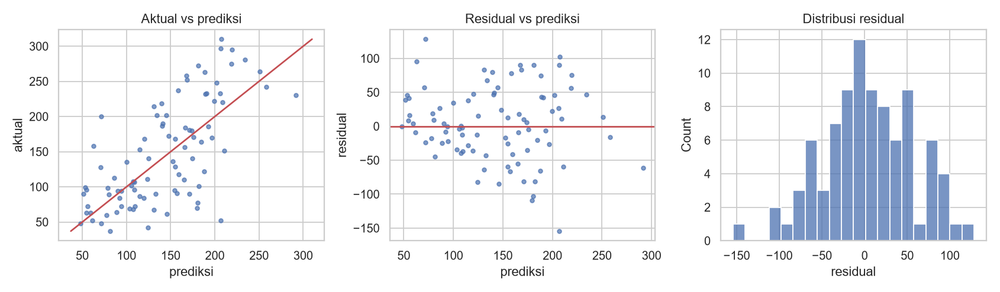

# Metrik Regresi dan Analisis Residual

## Tujuan pembelajaran

- [x] Menghitung dan menafsirkan MAE, MSE, RMSE, dan R².
- [x] Membuat dan membaca plot residual.
- [x] Mengenali masalah seperti galat yang membesar pada rentang tertentu (heteroskedastisitas).

## Metrik

Dengan nilai sebenarnya \(y_i\), prediksi \(\hat{y}_i\), residual \(e_i = y_i - \hat{y}_i\), dan \(n\) sampel:

$$
\text{MAE} = \frac{1}{n}\sum_i |e_i|, \quad
\text{MSE} = \frac{1}{n}\sum_i e_i^2, \quad
\text{RMSE} = \sqrt{\text{MSE}}, \quad
R^2 = 1 - \frac{\sum_i e_i^2}{\sum_i (y_i - \bar{y})^2}
$$

| Metrik | Satuan | Sifat | Kapan dipakai |
|---|---|---|---|
| MAE | Sama dengan target | Rata-rata galat; tahan *outlier* | Galat tipikal mudah dijelaskan |
| MSE | Kuadrat satuan target | Menghukum galat besar | Fungsi tujuan optimasi |
| RMSE | Sama dengan target | Menghukum galat besar; ≥ MAE | Galat besar sangat merugikan |
| R² | Tanpa satuan | Proporsi variasi yang dijelaskan relatif terhadap rata-rata | Perbandingan lintas skala; bukan satu-satunya ukuran |

Metrik persentase seperti MAPE mudah dipahami tetapi bermasalah bila target bernilai nol atau mendekati nol. Rasio RMSE terhadap MAE yang jauh di atas 1 menandakan adanya galat besar sesekali.

## Residual

**Residual** adalah selisih nilai sebenarnya dan prediksi. Model yang baik memiliki residual yang tampak acak: rata-rata mendekati nol, tanpa pola terhadap prediksi, dan sebaran kira-kira sama di semua rentang. Pola yang jelas berarti ada struktur yang belum ditangkap:

| Pola pada plot residual vs prediksi | Arti | Tindakan |
|---|---|---|
| Lengkungan | Hubungan non-linear terlewat | Fitur polinomial, model non-linear |
| Corong (galat melebar) | Varians tidak konstan | Transformasi target (log), metrik relatif |
| Kelompok terpisah | Variabel penting hilang | Tambah fitur atau fitur kelompok |

## Implementasi langkah demi langkah

Model: regresi linear pada Diabetes (data uji 89 sampel). Program `examples/estimation/residual_analysis.py`; program lengkap ada di akhir bagian ini.

### Langkah 1: melatih model dan menghitung residual

```python title="residual_analysis.py" linenums="16"
--8<-- "estimation/residual_analysis.py:16:20"
```

`pred = model.predict(X_test)` adalah prediksi untuk data uji. `resid = y_test - pred` menghitung **residual**: nilai sebenarnya dikurangi prediksi. Residual positif berarti model memprediksi terlalu rendah; negatif berarti terlalu tinggi. Karena `y_test` dan `pred` sejajar, hasilnya satu angka per sampel uji.

### Langkah 2: metrik ringkas

```python title="residual_analysis.py" linenums="22"
--8<-- "estimation/residual_analysis.py:22:24"
```

```text
--8<-- "expected/estimation/residual_analysis.txt:1:1"
```

**Interpretasi.** MAE 42,79; MSE 2900,2; RMSE 53,85; R² 0,453. RMSE/MAE = 1,26: ada beberapa galat yang lebih besar dari tipikal.

### Langkah 3: ringkasan residual

**Konsep.** Residual model yang baik tampak acak: rata-rata mendekati nol, simetris, dan sebarannya tidak bergantung pada nilai prediksi.

```python title="residual_analysis.py" linenums="26"
--8<-- "estimation/residual_analysis.py:26:29"
```

`resid.mean()`, `resid.std()`, `resid.skew()` (kemiringan), `resid.min()`, `resid.max()` meringkas distribusi residual. `np.corrcoef(np.abs(resid), pred)[0, 1]` menghitung korelasi antara **besar** galat (`np.abs`) dan nilai prediksi: bila positif, galat membesar di prediksi tinggi.

```text
--8<-- "expected/estimation/residual_analysis.txt:3:4"
```

**Interpretasi.** Rata-rata residual +3,91 (mendekati nol; sedikit positif karena sampel uji kecil), simpangan baku 54,02, *skewness* -0,18 (hampir simetris), rentang -154,5 sampai +128,3. Korelasi |residual| dengan prediksi 0,28 menunjukkan indikasi awal bahwa galat membesar pada prediksi yang lebih tinggi.

### Langkah 4: galat per rentang prediksi

```python title="residual_analysis.py" linenums="31"
--8<-- "estimation/residual_analysis.py:31:33"
```

| Kode | Penjelasan |
|---|---|
| `pd.qcut(pd.Series(pred, ...), 3, labels=[...])` | Membagi prediksi menjadi 3 kelompok berukuran sama (tertil): rendah, sedang, tinggi. |
| `resid.abs().groupby(bins, observed=True).mean()` | Rata-rata galat mutlak (MAE) di tiap kelompok. |

```text
--8<-- "expected/estimation/residual_analysis.txt:6:9"
```

**Interpretasi.** MAE per tertil prediksi adalah 26,9 (rendah), 48,8 (sedang), dan 52,8 (tinggi): galat lebih besar pada prediksi tinggi, indikasi varians tidak konstan (heteroskedastisitas). Dengan 89 sampel ini hanya petunjuk, bukan bukti pasti.

### Langkah 5: galat terbesar

```python title="residual_analysis.py" linenums="35"
--8<-- "estimation/residual_analysis.py:35:39"
```

`resid.abs().sort_values(ascending=False).head(3).index` mengambil **indeks** tiga sampel dengan galat mutlak terbesar. Perulangan mencetak nilai aktual, prediksi, dan residual (`:+.0f` selalu menampilkan tanda + atau -).

```text
--8<-- "expected/estimation/residual_analysis.txt:11:14"
```

**Interpretasi.** Sampel 56 (aktual 52, prediksi 206, residual -154), sampel 77 (aktual 200, prediksi 72, +128), sampel 211 (aktual 70, prediksi 180, -110). Memeriksa kasus ekstrem seperti ini sering mengungkap data salah, fitur yang hilang, atau kelompok khusus.

### Langkah 6: gambar diagnostik

```python title="residual_analysis.py" linenums="41"
--8<-- "estimation/residual_analysis.py:41:55"
```

Tiga grafik berdampingan: (1) *scatter* prediksi vs aktual dengan garis diagonal `lims` sebagai "prediksi sempurna"; (2) *scatter* prediksi vs residual dengan garis horizontal di 0; (3) histogram residual.



**Cara membaca.**

- **Aktual vs prediksi** (kiri): sumbu-x prediksi, sumbu-y nilai sebenarnya. Titik tersebar lebar di sekitar diagonal merah; model cenderung **menyusutkan** ke tengah (prediksi tidak menjangkau nilai target ekstrem rendah dan tinggi), ciri model dengan sinyal terbatas.
- **Residual vs prediksi** (tengah): idealnya awan titik acak di sekitar garis 0 dengan lebar sama. Di sini terlihat melebar pada prediksi tinggi, konsisten dengan angka per tertil.
- **Histogram residual** (kanan): mendekati lonceng simetris di sekitar 0, tanda tidak ada kemiringan besar.

??? example "Program lengkap (`residual_analysis.py`)"
    ```python title="residual_analysis.py" linenums="1"
    --8<-- "estimation/residual_analysis.py"
    ```

## Kesalahan umum

!!! warning "Hindari"
    - Melaporkan R² saja tanpa melihat residual.
    - Membandingkan RMSE antar dataset dengan skala target berbeda.
    - Memakai MAPE pada target yang bisa bernilai nol.
    - Menganggap residual berpola sebagai "derau".
    - Mengevaluasi residual pada data latih saja.

## Latihan

1. Latih model pada `log(target)` dan hitung ulang metrik pada skala asli. Apakah MAE per tertil lebih merata?
2. Hitung MAE untuk 10% prediksi tertinggi.
3. Buat plot residual terhadap fitur `bmi`. Adakah pola?
4. Mengapa RMSE selalu ≥ MAE?

## Ringkasan

MAE dan RMSE memberi galat dalam satuan target, R² membandingkan dengan prediksi rata-rata. Metrik ringkas harus dilengkapi analisis residual untuk menemukan pola yang tidak tertangkap model.

Berikutnya: [Validasi Silang dan Optimasi](validation-tuning.md).
