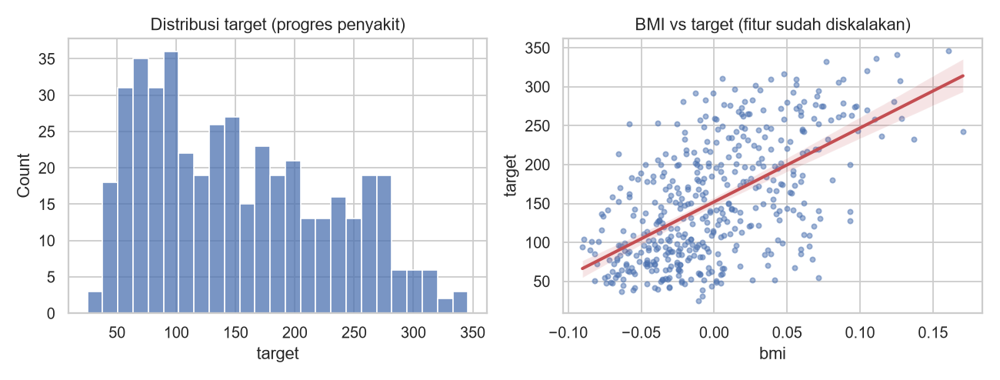

# Alur Kerja dan Data Regresi

## Tujuan pembelajaran

- [x] Merumuskan masalah regresi dan membedakannya dari klasifikasi.
- [x] Memahami tahap alur kerja yang berbeda pada regresi.
- [x] Mengenal dataset Diabetes: sumber, fitur, target, dan batasannya.
- [x] Memeriksa distribusi target, korelasi, dan multikolinearitas sebelum memodelkan.

## Apa itu regresi (estimasi)?

Regresi adalah *supervised learning* dengan target **numerik kontinu**: harga rumah, konsumsi listrik, lama pengiriman. Model memetakan fitur \(X\) ke nilai \(y\), dan kualitasnya diukur dari besar selisih (galat) antara prediksi dan nilai sebenarnya.

## Yang berbeda dari klasifikasi

| Aspek | Klasifikasi | Regresi |
|---|---|---|
| Target | Kelas diskret | Angka kontinu |
| Pembagian data | *Stratified* menurut kelas | Acak biasa (target kontinu tidak distratifikasi langsung) |
| *Baseline* | Kelas mayoritas | Rata-rata (atau median) target |
| Metrik | Precision, recall, F1, AUC | MAE, RMSE, R² |
| Diagnostik | *Confusion matrix*, ROC | Analisis residual |
| Perhatian khusus | Kelas tidak seimbang | Distribusi miring target, *outlier*, ekstrapolasi |

Tahap lain (EDA, praproses, validasi silang, optimasi, penyimpanan) mengikuti pola yang sudah dipelajari di bab [Klasifikasi](../classification/index.md) dan [Dasar-dasar](../fundamentals/index.md); lesson di bab ini hanya membahas apa yang berbeda.

## Dataset: Diabetes

- **Sumber dan akses**: dataset publik bawaan scikit-learn (`load_diabetes`), tanpa unduhan. Dokumentasi: [scikit-learn toy datasets](https://scikit-learn.org/stable/datasets/toy_dataset.html). Dataset ini dikaitkan dengan makalah Efron, Hastie, Johnstone, dan Tibshirani, *Least Angle Regression* (*Annals of Statistics*, 2004); rujuk dokumentasi scikit-learn untuk ketentuan penggunaan.
- **Isi**: 442 pasien, 10 fitur dasar: `age`, `sex`, `bmi`, `bp` (tekanan darah rata-rata), dan enam pengukuran serum darah `s1`–`s6`.
- **Target**: ukuran kuantitatif progres penyakit satu tahun setelah pengukuran awal (angka kontinu).
- **Batasan**: fitur sudah **dipusatkan dan diskalakan** oleh scikit-learn, sehingga nilainya tidak lagi dalam satuan asli (usia dalam tahun, dsb.) dan tidak dapat ditafsirkan langsung. Ukuran data kecil dan sinyalnya terbatas, jadi dataset ini cocok untuk belajar, bukan untuk kesimpulan medis.

## Pemeriksaan data awal langkah demi langkah

Program `examples/estimation/workflow_data.py`; program lengkap ada di akhir bagian ini.

### Langkah 1: memuat data dan memeriksa kualitasnya

**Tujuan.** Mengenal ukuran data dan memastikan tidak ada data hilang atau duplikat.

```python title="workflow_data.py" linenums="1"
--8<-- "estimation/workflow_data.py:1:16"
```

| Kode | Penjelasan |
|---|---|
| `load_diabetes(as_frame=True)` | Memuat dataset sebagai objek berisi tabel pandas. |
| `X, y = data.data, data.target` | `X` = tabel 10 fitur; `y` = target numerik (progres penyakit). |
| `X.isna().any().any()` | "Adakah sel kosong di mana pun?" (`any()` pertama per kolom, kedua gabungan). |
| `X.duplicated().sum()` | Jumlah baris duplikat. |

```text
--8<-- "expected/estimation/workflow_data.txt:1:2"
```

**Hasil.** Bentuk `(442, 10)`: 442 pasien, 10 fitur; tanpa data hilang dan tanpa duplikat.

### Langkah 2: memeriksa target

**Konsep.** Pada regresi, distribusi target menentukan metrik dan perlu tidaknya transformasi. Target yang sangat miring sering ditransformasi dengan logaritma.

```python title="workflow_data.py" linenums="18"
--8<-- "estimation/workflow_data.py:18:20"
```

Statistik target: `y.min()`, `y.median()`, `y.mean()`, `y.max()`, `y.std()` (simpangan baku), dan `y.skew()` (kemiringan). Format `%.0f` untuk bilangan tanpa desimal dan `%.1f` satu desimal.

```text
--8<-- "expected/estimation/workflow_data.txt:4:4"
```

**Interpretasi.** Target berkisar 25–346 dengan median 140 dan rata-rata 152,1; simpangan baku 77,1 dan *skewness* 0,44 (miring ringan ke kanan). Belum perlu transformasi log. Simpangan baku 77,1 juga menjadi patokan: model baru bermanfaat bila galatnya jauh di bawah angka itu.

### Langkah 3: apakah fitur sudah diskalakan?

```python title="workflow_data.py" linenums="22"
--8<-- "estimation/workflow_data.py:22:24"
```

`X.mean().abs().max()` mengambil rata-rata tiap kolom, nilai mutlaknya, lalu yang terbesar; `%.1e` mencetak dalam notasi ilmiah. `X.pow(2).sum()` adalah jumlah kuadrat tiap kolom, dan `.unique()` menunjukkan nilai berbeda yang muncul.

```text
--8<-- "expected/estimation/workflow_data.txt:6:7"
```

**Interpretasi.** Rata-rata tiap fitur ≈ 0 (maksimum 2,3×10⁻¹⁶, yaitu nol akibat pembulatan komputer) dan jumlah kuadratnya tepat 1: scikit-learn sudah **memusatkan dan menskalakan** fitur ini. Akibatnya nilainya tidak lagi dalam satuan asli (usia dalam tahun, dsb.) dan tidak dapat ditafsirkan langsung. *Scaling* tambahan tidak wajib, tetapi tetap dimasukkan ke `Pipeline` pada pelajaran berikutnya agar kodenya konsisten dan aman bila fitur diganti.

### Langkah 4: korelasi fitur dengan target

```python title="workflow_data.py" linenums="26"
--8<-- "estimation/workflow_data.py:26:28"
```

`X.corrwith(y)` menghitung korelasi tiap kolom `X` dengan `y`; `.sort_values(ascending=False)` mengurutkan dari terbesar.

```text
--8<-- "expected/estimation/workflow_data.txt:9:19"
```

**Interpretasi.** `bmi` (0,59) dan `s5` (0,57) paling kuat, lalu `bp` (0,44), `s4` (0,43); `s3` berkorelasi negatif (-0,39); `sex` nyaris nol (0,04). Korelasi mengukur hubungan linear dan bukan sebab-akibat.

### Langkah 5: multikolinearitas (fitur yang saling berkorelasi)

**Konsep.** Bila dua fitur sangat berkorelasi, model linear sulit membagi pengaruhnya dan koefisien menjadi tidak stabil.

```python title="workflow_data.py" linenums="30"
--8<-- "estimation/workflow_data.py:30:33"
```

`X.corr().abs()` adalah matriks korelasi antar-fitur dalam nilai mutlak. `.where(~np.eye(...))` mengosongkan diagonal (korelasi fitur dengan dirinya = 1 tidak menarik). `.stack()` meratakan matriks menjadi daftar pasangan, lalu diurutkan dan diambil yang terbesar.

```text
--8<-- "expected/estimation/workflow_data.txt:21:21"
```

**Interpretasi.** Pasangan `s1` dan `s2` berkorelasi 0,90. Hal ini akan terlihat pada koefisien regresi linear di pelajaran berikutnya.

### Langkah 6: gambar

```python title="workflow_data.py" linenums="35"
--8<-- "estimation/workflow_data.py:35:45"
```

`sns.histplot(y, bins=25)` menggambar histogram target. `sns.regplot(x=X["bmi"], y=y)` menggambar *scatter plot* BMI terhadap target beserta garis tren linear (garis merah) dan titik semi-transparan (`alpha=0.5`).



**Cara membaca.** Histogram (kiri): sumbu-x adalah nilai target, sumbu-y jumlah pasien; bentuknya sedikit miring ke kanan. Scatter (kanan): tiap titik satu pasien; sumbu-x BMI (sudah diskalakan, sehingga bukan dalam satuan asli), sumbu-y target; garis naik menunjukkan hubungan positif, tetapi sebarannya lebar sehingga bahkan fitur terkuat hanya menjelaskan sebagian variasi.

??? example "Program lengkap (`workflow_data.py`)"
    ```python title="workflow_data.py" linenums="1"
    --8<-- "estimation/workflow_data.py"
    ```

## Kesalahan umum

!!! warning "Hindari"
    - Memakai metrik klasifikasi (akurasi) pada target numerik.
    - Menafsirkan koefisien pada fitur yang sudah diskalakan seolah masih dalam satuan asli.
    - Mengabaikan distribusi target dan *outlier* sebelum memilih metrik.
    - Memakai *stratified split* pada target kontinu tanpa membuat kelompok (*bin*) terlebih dulu.

## Latihan

1. Ubah target menjadi `log(target)` lalu hitung *skewness*-nya. Apakah lebih simetris?
2. Hitung korelasi Spearman fitur–target dan bandingkan dengan Pearson.
3. Buat *scatter plot* `s5` terhadap target.

## Ringkasan

Regresi memprediksi angka kontinu dan dievaluasi dengan MAE, RMSE, dan R². Periksa distribusi target, korelasi, dan multikolinearitas sebelum memodelkan; kenali bahwa fitur Diabetes sudah diskalakan.

Berikutnya: [Baseline dan Regresi Linear](linear-regression.md).
