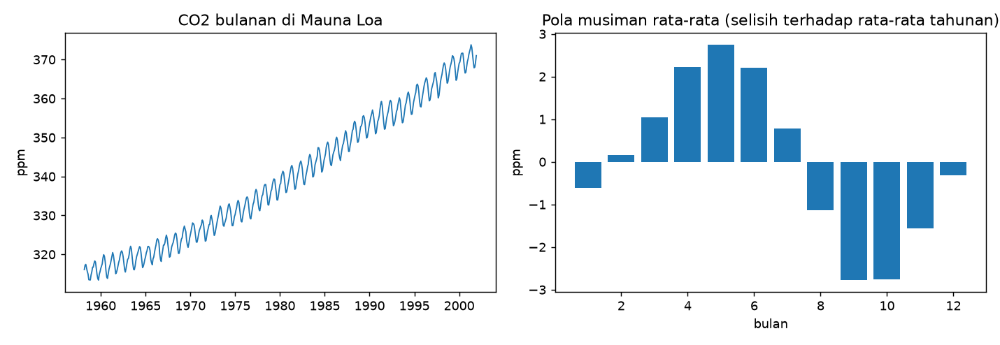

# Data Deret Waktu dan EDA

## Tujuan pembelajaran

- [x] Memeriksa indeks waktu: frekuensi, rentang, dan timestamp yang hilang.
- [x] Membedakan *timestamp* hilang dari nilai hilang (`NaN`) dan menanganinya.
- [x] Mengagregasi (*resample*) deret ke frekuensi lain.
- [x] Melakukan EDA khas deret waktu: tren, pola musiman, dan laju pertumbuhan.

## Dataset: CO2 Mauna Loa

- **Sumber dan akses**: konsentrasi CO2 atmosfer mingguan di Mauna Loa, Hawaii (ppm), Maret 1958–Desember 2001, dibundel dengan statsmodels (`statsmodels.datasets.co2`), tanpa unduhan. Kutipan dari dokumentasi dataset: Keeling, C.D. dan T.P. Whorf (2004), *Atmospheric CO2 concentrations derived from flask air samples at sites in the SIO network*, Carbon Dioxide Information Analysis Center, Oak Ridge National Laboratory. Dokumentasi statsmodels menyatakan data ini domain publik.
- **Isi**: 2284 baris mingguan satu variabel (`co2`), indeks tanggal.
- **Batasan**: berhenti pada 2001; deret fisik yang halus dengan tren dan musiman yang sangat jelas, jadi lebih mudah diprediksi daripada banyak deret bisnis. Dipakai sebagai alat belajar.

Fungsi bantu `forecast_utils.py` (memuat data bulanan dan menghitung metrik) dipakai di seluruh bab ini.

??? example "Kode fungsi bantu (`forecast_utils.py`)"
    ```python title="forecast_utils.py"
    --8<-- "forecasting/forecast_utils.py"
    ```

## Pemeriksaan data langkah demi langkah

Program `examples/forecasting/co2_eda.py`; program lengkap ada di akhir bagian ini.

### Langkah 1: struktur waktu

**Tujuan.** Memastikan indeks berupa tanggal, urut, dan berjarak teratur.

```python title="co2_eda.py" linenums="1"
--8<-- "forecasting/co2_eda.py:1:15"
```

| Kode | Penjelasan |
|---|---|
| `co2.load_pandas().data["co2"]` | Memuat dataset bawaan statsmodels sebagai `DataFrame` dan mengambil kolom `co2` sebagai `Series` berindeks tanggal. |
| `weekly.index.min().date()` | Tanggal paling awal dan paling akhir pada indeks. |
| `weekly.index.to_series().diff().dt.days.dropna().unique()` | Mengubah indeks menjadi `Series`, menghitung selisih antar-tanggal (`diff()`), mengambil jumlah hari (`.dt.days`), dan melihat nilai yang berbeda (`unique()`). |

```text
--8<-- "expected/forecasting/co2_eda.txt:1:2"
```

**Hasil.** Data berawal 1958-03-29 dan berakhir 2001-12-29 dengan 2284 baris; setiap baris berjarak tepat 7 hari, jadi frekuensinya mingguan dan teratur.

### Langkah 2: nilai hilang (`NaN`)

```python title="co2_eda.py" linenums="17"
--8<-- "forecasting/co2_eda.py:17:19"
```

`weekly.isna().sum()` menghitung nilai kosong. Baris kedua mengelompokkan nilai kosong menurut dekade: `index.year // 10 * 10` membulatkan tahun ke dekade (1958 → 1950), lalu `.size()` menghitung jumlah per kelompok.

```text
--8<-- "expected/forecasting/co2_eda.txt:4:5"
```

**Hasil.** 59 nilai mingguan kosong, sebagian besar pada 1958–1964, satu pada 1970-an, dan lima pada 1980-an. Tanggalnya ada, hanya nilainya kosong.

### Langkah 3: *timestamp* hilang berbeda dari nilai hilang

**Konsep.** *Timestamp* hilang berarti **barisnya tidak ada** sama sekali, sehingga lag "satu langkah sebelumnya" tidak lagi berarti satu minggu. Untuk memperagakannya, tiga baris dihapus **secara sengaja** (simulasi buatan).

```python title="co2_eda.py" linenums="21"
--8<-- "forecasting/co2_eda.py:21:26"
```

| Kode | Penjelasan |
|---|---|
| `weekly.drop(weekly.index[[100, 101, 500]])` | Menghapus tiga baris pada posisi 100, 101, dan 500. |
| `pd.date_range(min, max, freq="7D")` | Membangun indeks **lengkap** tiap 7 hari dari tanggal awal ke akhir. |
| `full_index.difference(gappy.index)` | Tanggal yang ada di indeks lengkap tetapi tidak di data = tanggal yang hilang. |
| `gappy.asfreq("7D")` | Memaksa deret memiliki frekuensi 7 hari: baris yang hilang ditambahkan dengan nilai `NaN`. |

```text
--8<-- "expected/forecasting/co2_eda.txt:7:8"
```

**Hasil.** Ketiga tanggal hilang terdeteksi (1960-02-27, 1960-03-05, 1967-10-28), dan `asfreq` mengembalikan 2284 baris dengan 3 `NaN` baru. Selalu periksa *timestamp* dan nilai hilang sebelum memodelkan.

### Langkah 4: agregasi bulanan dan mengisi bulan kosong

```python title="co2_eda.py" linenums="28"
--8<-- "forecasting/co2_eda.py:28:34"
```

| Kode | Penjelasan |
|---|---|
| `weekly.resample("MS").mean()` | Mengelompokkan data mingguan per bulan (`MS` = awal bulan) dan merata-ratakannya. Bulan yang seluruh minggunya kosong menjadi `NaN`. |
| `interpolate(method="time")` | Mengisi `NaN` dengan interpolasi linear menurut **jarak waktu** antara titik sebelum dan sesudahnya. |
| `ffill()` | *Forward fill*: menyalin nilai valid terakhir ke depan. |

```text
--8<-- "expected/forecasting/co2_eda.txt:10:11"
```

**Interpretasi.** Terdapat 5 bulan tanpa data: 1958-06, 1958-10, dan 1964-02 sampai 1964-04. Interpolasi waktu mengisi tiga bulan 1964 dengan 320,07, 320,69, 321,36 ppm (mengikuti tren), sedangkan `ffill` menyalin 319,4 untuk ketiganya sehingga menghasilkan "datar buatan" yang mengabaikan tren dan musim. Interpolasi memakai nilai **sebelum dan sesudah** celah. Itu aman di sini karena semua celah berada jauh di dalam data latih; untuk celah di dekat data uji atau pada saat prediksi, hanya boleh memakai nilai masa lalu (`ffill`) atau metode yang tidak melihat ke depan.

### Langkah 5: ringkasan pola (tren dan musiman)

```python title="co2_eda.py" linenums="36"
--8<-- "forecasting/co2_eda.py:36:45"
```

| Kode | Penjelasan |
|---|---|
| `m.groupby(m.index.year).mean()` | Rata-rata per tahun. |
| `(annual[1980] - annual[1960]) / 20` | Kenaikan rata-rata per tahun antara 1960 dan 1980. |
| `m.groupby(m.index.year).transform("mean")` | Rata-rata tahunan dari tiap bulan, dijajarkan ke bentuk data bulanan; `m - ...` menghasilkan selisih terhadap rata-rata tahunnya (menghilangkan tren antar-tahun). |
| `detr.groupby(detr.index.month).mean()` | Rata-rata selisih itu untuk tiap bulan kalender = pola musiman rata-rata. |

```text
--8<-- "expected/forecasting/co2_eda.txt:13:15"
```

**Interpretasi.** Rata-rata tahunan 316,9 ppm (1960), 338,6 (1980), 369,4 (2000); kenaikan rata-rata 1,09 ppm per tahun pada 1960–1980 dan 1,54 pada 1980–2000, yaitu tren yang menanjak. Pola musiman: puncak pada Mei (+2,7 ppm dari rata-rata tahunan) dan lembah pada September (-2,8 ppm).

### Langkah 6: gambar

```python title="co2_eda.py" linenums="47"
--8<-- "forecasting/co2_eda.py:47:55"
```



**Cara membaca.** Kiri: sumbu-x tahun, sumbu-y konsentrasi CO2 (ppm); garis naik dengan gelombang kecil berulang tiap tahun (tren plus musiman). Kanan: sumbu-x bulan 1–12, sumbu-y selisih terhadap rata-rata tahunan; batang positif di musim semi (puncak sekitar Mei), negatif di akhir musim panas dan awal musim gugur (lembah sekitar September–Oktober).

??? example "Program lengkap (`co2_eda.py`)"
    ```python title="co2_eda.py" linenums="1"
    --8<-- "forecasting/co2_eda.py"
    ```

## Praproses deret waktu: aturan

1. Pastikan indeks bertipe `DatetimeIndex`, terurut, tanpa duplikat, dan memiliki frekuensi tetap.
2. Tangani nilai dan timestamp hilang dengan cara yang **tidak memakai informasi masa depan** relatif terhadap titik prediksi.
3. Jangan imputasi acak atau memakai rata-rata global; gunakan interpolasi atau pengisian yang mempertimbangkan waktu.
4. Agregasi ke frekuensi yang sesuai dengan keputusan bisnis (harian vs bulanan).
5. Periksa *outlier* dan perubahan struktural (lonjakan, perubahan definisi data).

## Kesalahan umum

!!! warning "Hindari"
    - Mengisi nilai hilang memakai statistik seluruh deret (termasuk masa depan).
    - Mengacak urutan sebelum EDA atau pemodelan.
    - Membiarkan timestamp hilang sehingga lag tidak lagi berarti "bulan lalu".
    - Mengabaikan perubahan frekuensi atau zona waktu.

## Latihan

1. Hitung rata-rata CO2 per bulan untuk 1990-an dan bandingkan dengan 1960-an. Apakah amplitudo musimannya berubah?
2. Isi bulan yang hilang dengan `ffill` lalu bandingkan MAE seasonal naive (lihat lesson validasi) terhadap interpolasi.
3. Hitung `weekly.resample("QS").mean()` dan bandingkan dengan agregasi bulanan.

## Ringkasan

EDA deret waktu memeriksa indeks, celah, pola tren, dan musiman. Tangani nilai hilang dengan metode yang sadar waktu dan tidak membocorkan masa depan.

Berikutnya: [Fitur Waktu dan Lag](features.md).
