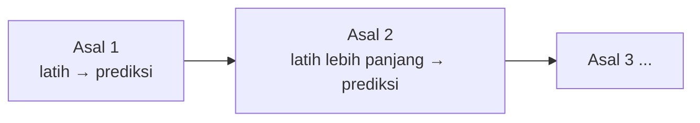

# Validasi Kronologis dan Metrik Forecasting

## Tujuan pembelajaran

- [x] Membagi deret waktu secara kronologis menjadi latih, validasi, dan uji.
- [x] Menjelaskan mengapa validasi silang acak menyesatkan pada deret waktu.
- [x] Memakai *rolling-origin evaluation*.
- [x] Menghitung dan menafsirkan MAE, RMSE, sMAPE, dan MASE.

## Pembagian kronologis

Pada forecasting, model dilatih pada masa lalu dan diuji pada **masa depan** relatif terhadap data latih:

```text
|----------- latih -----------|--- validasi ---|--- uji ---|
 awal                                                  akhir
```

Data tidak pernah diacak. Data uji adalah bagian paling akhir dan dipakai satu kali. Untuk model akhir, data latih dan validasi biasanya digabung lalu dilatih ulang sebelum memprediksi data uji.

## Rolling-origin evaluation

Satu pembagian saja bisa kebetulan mudah atau sulit. ***Rolling origin*** mengulangi evaluasi dari beberapa titik asal: latih pada data sampai titik asal, prediksi *horizon* \(h\) langkah ke depan, lalu geser titik asal (jendela latih **membesar**, *expanding window*) dan ulangi. Hasilnya adalah beberapa skor yang dirata-rata beserta sebarannya.



## Metrik

Dengan nilai sebenarnya \(y_t\), prediksi \(\hat{y}_t\), dan \(n\) titik evaluasi:

$$
\text{MAE} = \frac{1}{n}\sum_t |y_t - \hat{y}_t|, \quad
\text{RMSE} = \sqrt{\frac{1}{n}\sum_t (y_t - \hat{y}_t)^2}, \quad
\text{sMAPE} = \frac{100}{n}\sum_t \frac{2\,|y_t - \hat{y}_t|}{|y_t| + |\hat{y}_t|}
$$

$$
\text{MASE} = \frac{\text{MAE}}{\frac{1}{N-m}\sum_{t=m+1}^{N} |y_t - y_{t-m}|}
$$

Penyebut MASE adalah MAE metode *seasonal naive* (periode \(m\)) **pada data latih** sepanjang \(N\) titik. MASE tanpa satuan, sehingga dapat dibandingkan antar deret; MASE di bawah 1 berarti galat lebih kecil daripada galat tipikal prediksi seasonal naive dalam sampel. MAPE biasa bermasalah bila nilai sebenarnya mendekati nol; MASE dan sMAPE lebih aman.

## Implementasi langkah demi langkah

Memakai CO2 bulanan ([Data dan EDA](data-eda.md)). Program `examples/forecasting/splitting_eval.py`; program lengkap ada di akhir bagian ini.

### Langkah 1: pembagian kronologis

**Tujuan.** Membagi deret menjadi tiga bagian berurutan tanpa mengacak.

```python title="splitting_eval.py" linenums="1"
--8<-- "forecasting/splitting_eval.py:1:13"
```

| Kode | Penjelasan |
|---|---|
| `y.iloc[-24:]` | 24 baris **terakhir** (indeks negatif menghitung dari belakang) = data uji. |
| `y.iloc[-48:-24]` | 24 baris sebelumnya = data validasi. |
| `y.iloc[:-48]` | Seluruh baris sebelum itu = data latih. |
| `part.index[0].strftime('%Y-%m')` | Mengubah tanggal pertama bagian itu menjadi teks `tahun-bulan`. |

```text
--8<-- "expected/forecasting/splitting_eval.txt:1:3"
```

**Hasil.** Latih 478 bulan (1958-03 s.d. 1997-12), validasi 24 bulan (1998–1999), uji 24 bulan (2000–2001): selalu "masa lalu → masa depan".

### Langkah 2: mengapa tidak boleh diacak

**Konsep.** Untuk memperlihatkan efeknya, Random Forest dilatih pada fitur lag (nilai 1, 2, 3, dan 12 bulan lalu) dan dinilai dengan dua cara: validasi silang **acak** dan evaluasi **kronologis**.

```python title="splitting_eval.py" linenums="15"
--8<-- "forecasting/splitting_eval.py:15:37"
```

| Kode | Penjelasan |
|---|---|
| `pd.DataFrame({f"lag_{k}": y.shift(k) for k in [1, 2, 3, 12]})` | Tabel fitur lag (`shift(k)` menggeser deret `k` bulan; lihat [Fitur Waktu dan Lag](features.md)). Dibuat dengan *dictionary comprehension*. |
| `lags.assign(target=y).dropna()` | Menambahkan kolom `target` (level CO2) dan membuang baris awal yang kosong. |
| `KFold(5, shuffle=True, ...).split(X_all)` | (a) Pembagian **acak**: baris dibagi acak ke 5 lipatan. |
| `cut = len(X_all) - 48` lalu `iloc[:cut]` vs `iloc[cut:cut + 24]` | (b) Pembagian **kronologis**: latih pada awal, uji pada 24 bulan setelahnya. |

```text
--8<-- "expected/forecasting/splitting_eval.txt:5:7"
```

**Interpretasi.** RMSE Random Forest 0,64 ppm pada `KFold` acak, tetapi **2,56 ppm** pada evaluasi kronologis: selisih empat kali lipat. Pada `KFold` acak, tiap bulan yang diuji dikelilingi bulan latih yang bertetangga di kedua sisi (model "menginterpolasi"). Pada evaluasi kronologis, model harus meramal masa depan: rentang target validasi (363,9–371,0) sebagian di atas nilai terbesar data latih (366,7), padahal pohon tidak dapat memprediksi di luar rentang yang pernah dilihatnya. Validasi silang acak memberi gambaran yang terlalu optimis.

### Langkah 3: metrik forecasting

**Konsep.** Berikut metrik standar forecasting yang dihitung oleh fungsi bantu di `forecast_utils.py` (rumusnya ada di bagian Metrik di atas). Contoh memakai prediksi *seasonal naive*: nilai tiap bulan diprediksi sama dengan bulan yang sama setahun lalu.

```python title="splitting_eval.py" linenums="39"
--8<-- "forecasting/splitting_eval.py:39:42"
```

`seasonal_naive(train, 24)` mengulang 12 nilai terakhir data latih untuk 24 bulan ke depan. Metrik dihitung terhadap `valid` (nilai sebenarnya).

```text
--8<-- "expected/forecasting/splitting_eval.txt:9:9"
```

**Interpretasi.** MAE 3,72; RMSE 3,83; sMAPE 1,017%; MASE 2,98. MASE ≈ 3 berarti galatnya sekitar tiga kali galat tahun-ke-tahun tipikal pada data latih (MAE tahun-ke-tahun data latih ≈ 1,25 ppm), karena tren terus naik dan prediksi hanya menyalin tahun lalu (pada tahun kedua horizon, prediksi tertinggal dua tahun).

### Langkah 4: *rolling-origin evaluation*

**Konsep.** Satu pembagian bisa kebetulan mudah atau sulit. Evaluasi diulang dari beberapa titik asal dengan jendela latih yang **membesar**.

```python title="splitting_eval.py" linenums="44"
--8<-- "forecasting/splitting_eval.py:44:53"
```

| Kode | Penjelasan |
|---|---|
| `range(len(y) - 12 - 5 * 12, len(y) - 11, 12)` | Enam titik asal berjarak 12 bulan, yang terakhir menyisakan tepat 12 bulan untuk diuji. `end` adalah jumlah data latih. |
| `tr, te = y.iloc[:end], y.iloc[end:end + 12]` | Latih pada awal sampai `end`; uji pada 12 bulan sesudahnya (horizon 12). |
| `maes.append(m)` | Menyimpan MAE tiap titik asal. |

```text
--8<-- "expected/forecasting/splitting_eval.txt:11:19"
```

**Interpretasi.** MAE per asal 1,76; 1,11; 2,91; 1,61; 1,14; 1,49; rata-rata **1,67 (± 0,60)**. Galat bergantung pada titik asal: asal 1997-12 (2,91) hampir tiga kali asal 1996-12 (1,11). Karena itu satu pembagian saja tidak cukup untuk menilai metode.

??? example "Program lengkap (`splitting_eval.py`)"
    ```python title="splitting_eval.py" linenums="1"
    --8<-- "forecasting/splitting_eval.py"
    ```

## Kesalahan umum

!!! warning "Hindari"
    - Memakai `train_test_split` atau `KFold` acak pada deret waktu.
    - Memilih model dengan data uji lalu melaporkan skor yang sama.
    - Membandingkan model pada horizon yang berbeda.
    - Memakai MAPE pada nilai yang dapat nol.
    - Tidak membandingkan dengan *baseline* naive/seasonal naive.

## Latihan

1. Ubah horizon rolling origin menjadi 6 dan 24 bulan. Bagaimana MAE seasonal naive berubah?
2. Gunakan `TimeSeriesSplit(n_splits=5)` dari scikit-learn dan bandingkan skor.
3. Ulangi demonstrasi `KFold` acak dengan model linear (bukan pohon). Apakah selisihnya masih besar?

## Ringkasan

Bagi data secara kronologis, jangan mengacak, dan gunakan *rolling origin* untuk estimasi yang lebih andal. Gunakan MAE/RMSE bersama MASE (dan sMAPE) dibanding *baseline* musiman.

Berikutnya: [Baseline, Moving Average, dan Exponential Smoothing](baselines.md).
