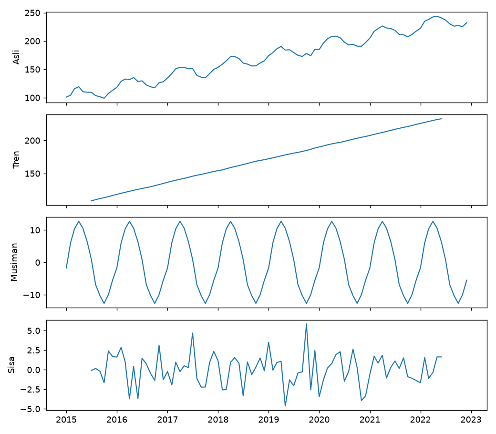

# Dasar Deret Waktu: Tren, Musiman, dan Derau

## Tujuan pembelajaran

- [x] Menjelaskan apa yang membuat data deret waktu berbeda dari data tabular biasa.
- [x] Mengenali komponen tren, musiman (*seasonality*), dan derau (*noise*).
- [x] Membedakan model aditif dan multiplikatif, serta membaca dekomposisi.
- [x] Memahami autokorelasi dan diferensiasi.

## Apa yang berbeda?

**Deret waktu** adalah pengamatan yang diurutkan menurut waktu pada selang yang teratur (harian, bulanan, ...). Tujuan forecasting adalah memprediksi nilai di masa depan dari nilai masa lalu. Konsekuensinya:

- **Urutan adalah informasi.** Mengacak data menghancurkannya, dan memakai data masa depan untuk memprediksi masa lalu menciptakan kebocoran.
- **Pengamatan saling bergantung** (autokorelasi), padahal banyak metode tabular mengasumsikan sampel independen.
- **Evaluasi harus kronologis** (dibahas di [lesson validasi](splitting-evaluation.md)).

## Komponen deret waktu

| Komponen | Arti |
|---|---|
| Indeks waktu | Penanda waktu tiap pengamatan, dengan frekuensi tetap (`MS` = awal bulan) |
| Tren (*trend*) | Arah jangka panjang naik atau turun |
| Musiman (*seasonality*) | Pola berulang pada periode tetap (misalnya 12 bulan) |
| Derau (*noise*, sisa) | Variasi acak yang tidak dapat dijelaskan |

Model **aditif** menjumlahkan komponen; model **multiplikatif** mengalikannya (cocok bila amplitudo musiman membesar mengikuti tren):

$$
y_t = T_t + S_t + \varepsilon_t \quad\text{(aditif)}, \qquad
y_t = T_t \times S_t \times \varepsilon_t \quad\text{(multiplikatif)}
$$

\(y_t\) nilai pada waktu \(t\), \(T_t\) tren, \(S_t\) komponen musiman, dan \(\varepsilon_t\) derau.

## Autokorelasi dan diferensiasi

**Autokorelasi** pada lag \(k\) adalah korelasi deret dengan dirinya sendiri yang digeser \(k\) langkah:

$$
r_k = \frac{\sum_{t=k+1}^{n} (y_t - \bar{y})(y_{t-k} - \bar{y})}{\sum_{t=1}^{n} (y_t - \bar{y})^2}
$$

Nilai tinggi pada lag 12 (data bulanan) menandakan pola tahunan. **Diferensiasi** mengganti nilai dengan selisih: \(y_t - y_{t-1}\) menghilangkan tren, \(y_t - y_{t-12}\) menghilangkan pola musiman tahunan. Metode seperti ARIMA bekerja pada deret yang sudah didiferensiasi.

## Implementasi langkah demi langkah

Memakai **deret sintetis** bulanan 96 titik yang dibangkitkan dari komponen yang kita tentukan sendiri (tren +1,5 per bulan, musiman bergelombang sinus amplitudo 12, derau normal dengan simpangan baku 3), sehingga hasil dekomposisi dapat diperiksa terhadap nilai sebenarnya. Program `examples/forecasting/ts_fundamentals.py`; program lengkap ada di akhir bagian ini.

### Langkah 1: membangun deret waktu dengan indeks tanggal

**Tujuan.** Menyusun `Series` pandas yang indeksnya adalah tanggal dengan frekuensi tetap, bentuk standar data deret waktu.

```python title="ts_fundamentals.py" linenums="12"
--8<-- "forecasting/ts_fundamentals.py:12:22"
```

| Kode | Penjelasan |
|---|---|
| `pd.date_range("2015-01-01", periods=96, freq="MS")` | Membuat 96 tanggal berurutan, satu per bulan; `MS` = *month start* (awal bulan). |
| `t = np.arange(96)` | Nomor urut waktu 0, 1, ..., 95. |
| `trend_true = 100 + 1.5 * t` | Tren naik 1,5 per bulan. |
| `12 * np.sin(2 * np.pi * (idx.month - 1) / 12)` | Pola musiman: gelombang sinus berperiode 12 bulan (berulang tiap tahun) dengan amplitudo 12. `idx.month` memberi bulan 1–12 dari tiap tanggal. |
| `rng.normal(0, 3, 96)` | Derau acak: rata-rata 0, simpangan baku 3 (seed 42 sehingga dapat diulang). |
| `pd.Series(..., index=idx)` | Menjumlahkan tiga komponen dan memberi indeks tanggal. |

```text
--8<-- "expected/forecasting/ts_fundamentals.txt:1:5"
```

**Hasil.** Indeks bulanan berfrekuensi `MS` dengan 96 pengamatan. Kita tahu persis komponen pembentuknya, sehingga langkah berikutnya dapat dinilai benar atau tidaknya.

### Langkah 2: dekomposisi

**Konsep.** Dekomposisi memisahkan deret menjadi tren, musiman, dan sisa. Pada model aditif: \(y_t = T_t + S_t + \varepsilon_t\).

```python title="ts_fundamentals.py" linenums="24"
--8<-- "forecasting/ts_fundamentals.py:24:29"
```

| Kode | Penjelasan |
|---|---|
| `seasonal_decompose(y, model="additive", period=12)` | Menguraikan deret; `period=12` berarti pola berulang tiap 12 titik. Hasilnya objek dengan atribut `.trend`, `.seasonal`, `.resid`. |
| `res.trend.dropna()` | Estimasi tren memakai rata-rata bergerak sehingga 6 titik di tiap ujung kosong (`NaN`); dibuang dulu. |
| `np.polyfit(t[6:-6], ..., 1)[0]` | Mencocokkan garis lurus pada tren; koefisien pertama adalah kemiringannya (naik berapa per bulan). |

```text
--8<-- "expected/forecasting/ts_fundamentals.txt:7:9"
```

**Interpretasi.** Dekomposisi memulihkan struktur dengan baik: kemiringan tren 1,49 (sebenarnya 1,50) dan amplitudo musiman 12,7 (sebenarnya 12,0). Simpangan baku sisa 1,96, lebih kecil dari derau sebenarnya (3,00): rata-rata bergerak yang dipakai mengestimasi tren dan musiman ikut menyerap sebagian derau, dan tren hilang di 6 titik pada tiap ujung. Dekomposisi adalah alat eksplorasi, bukan pengukuran presisi.

### Langkah 3: autokorelasi

**Konsep.** Autokorelasi pada lag \(k\) adalah korelasi deret dengan dirinya yang digeser \(k\) langkah.

```python title="ts_fundamentals.py" linenums="31"
--8<-- "forecasting/ts_fundamentals.py:31:33"
```

`acf(y, nlags=12)` mengembalikan autokorelasi untuk lag 0 sampai 12; `r[1]`, `r[6]`, `r[12]` mengambil lag 1, 6, dan 12.

```text
--8<-- "expected/forecasting/ts_fundamentals.txt:11:11"
```

**Interpretasi.** Autokorelasi tinggi: 0,96 (lag 1), 0,77 (lag 6), 0,63 (lag 12), terutama karena tren yang kuat: nilai sekarang dekat dengan nilai bulan lalu. Autokorelasi tinggi sendiri bukan bukti kemampuan prediksi.

### Langkah 4: diferensiasi

**Konsep.** Diferensiasi mengganti nilai dengan selisihnya. `y.diff()` (selisih 1 langkah) menghilangkan tren; `y.diff(12)` (selisih dengan 12 langkah sebelumnya) menghilangkan pola musiman tahunan.

```python title="ts_fundamentals.py" linenums="35"
--8<-- "forecasting/ts_fundamentals.py:35:40"
```

`.dropna()` membuang baris awal yang kosong karena tidak ada nilai sebelumnya untuk dikurangkan.

```text
--8<-- "expected/forecasting/ts_fundamentals.txt:13:14"
```

**Interpretasi.** Simpangan baku turun dari 41,7 (asli) menjadi 5,5 (selisih 1 bulan) dan 3,0 (selisih 12 bulan). Rata-rata selisih 12 bulan 17,9, hampir sama dengan 1,5 × 12 = 18, yaitu kenaikan tahunan akibat tren.

### Langkah 5: gambar komponen

```python title="ts_fundamentals.py" linenums="42"
--8<-- "forecasting/ts_fundamentals.py:42:49"
```

Empat grafik bertumpuk dengan sumbu-x bersama (`sharex=True`): deret asli, tren, musiman, dan sisa. `zip(axes, [...])` memasangkan tiap sumbu dengan satu deret untuk digambar dalam satu perulangan.



**Cara membaca.** Sumbu-x adalah waktu, sumbu-y nilai komponen. Panel kedua (tren) naik hampir lurus; panel ketiga (musiman) berulang identik tiap tahun; panel terakhir (sisa) berfluktuasi di sekitar nol tanpa pola, tanda komponen utama sudah terpisah.

??? example "Program lengkap (`ts_fundamentals.py`)"
    ```python title="ts_fundamentals.py" linenums="1"
    --8<-- "forecasting/ts_fundamentals.py"
    ```

## Kesalahan umum

!!! warning "Hindari"
    - Memperlakukan deret waktu sebagai data tabular independen dan mengacaknya.
    - Memakai periode musiman yang salah pada dekomposisi.
    - Menafsirkan autokorelasi tinggi sebagai bukti kemampuan prediksi; tren sendiri sudah menghasilkannya.
    - Memakai model aditif pada deret yang amplitudo musimannya membesar.

## Latihan

1. Ubah amplitudo musiman menjadi 30 dan derau menjadi 10. Bagaimana kualitas dekomposisi berubah?
2. Buat deret multiplikatif (`trend * season`), lalu bandingkan `model="additive"` dan `model="multiplicative"`.
3. Hitung ACF pada deret setelah `diff(1)` dan `diff(12)`. Apa yang berubah?

## Ringkasan

Deret waktu terdiri atas tren, musiman, dan derau; urutan dan autokorelasi menuntut cara evaluasi khusus. Dekomposisi dan diferensiasi membantu memahami dan menyiapkan deret.

Berikutnya: [Data Deret Waktu dan EDA](data-eda.md).
