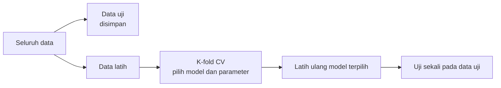

# Data Latih, Validasi, dan Uji

## Tujuan pembelajaran

- [x] Menjelaskan fungsi data latih, validasi, dan uji.
- [x] Memakai `train_test_split` dengan `stratify` dan `random_state`.
- [x] Menjelaskan validasi silang (*cross-validation*) dan kapan memakainya.
- [x] Memilih strategi pembagian yang sesuai jenis tugas.

## Mengapa data harus dibagi?

Model yang dinilai pada data yang sama dengan data pelatihannya akan tampak bagus meskipun hanya menghafal. Yang kita inginkan adalah **generalisasi**: performa pada data baru. Karena itu data dibagi:

| Bagian | Fungsi | Dipakai berapa kali? |
|---|---|---|
| Data latih (*training*) | Melatih model, termasuk *fit* praproses | Berulang |
| Data validasi (*validation*) | Membandingkan model dan menyetel hyperparameter | Berulang |
| Data uji (*test*) | Estimasi akhir performa model terpilih | **Sekali** |

Bila data uji dipakai berulang untuk memilih model, ia berubah fungsi menjadi data validasi dan estimasi akhirnya menjadi terlalu optimis.

## Validasi silang

Pada data kecil, satu data validasi terlalu bergantung pada pembagian yang kebetulan. *K-fold cross-validation* membagi data latih menjadi \(K\) lipatan; secara bergiliran satu lipatan menjadi validasi dan sisanya latih. Hasilnya \(K\) skor yang dirata-rata, ditambah gambaran sebarannya. Data uji tetap dipisahkan sejak awal dan tidak dipakai di sini.



## Strategi menurut jenis tugas

| Tugas | Strategi |
|---|---|
| Klasifikasi | *Stratified* split dan *stratified* K-fold (menjaga proporsi kelas) |
| Regresi | Split acak dan K-fold biasa |
| Forecasting | **Kronologis**: latih pada masa lalu, uji pada masa depan; jangan diacak (bab Forecasting) |
| Klastering | Tidak ada data uji berlabel; pakai indeks internal dan uji kestabilan (bab Klaster) |
| Aturan asosiasi | Tidak ada pembagian wajib; opsional memeriksa kestabilan aturan pada data lain |

## Implementasi langkah demi langkah

Contoh memakai data **sintetis** tidak seimbang (sekitar 10% kelas positif) dari `make_classification`. Program lengkap ada di akhir bagian ini.

### Langkah 1: membuat data dan memahami `X` dan `y`

**Konsep.** Dalam scikit-learn, `X` adalah **fitur** (tabel `jumlah_sampel × jumlah_fitur`) dan `y` adalah **target** (satu nilai per sampel). Kita memisahkannya agar model belajar memetakan `X` ke `y`.

```python title="data_splitting.py" linenums="1"
--8<-- "fundamentals/data_splitting.py:1:10"
```

| Kode | Penjelasan |
|---|---|
| `make_classification(n_samples=300, n_features=5, weights=[0.9, 0.1], random_state=SEED)` | Membuat 300 sampel dengan 5 fitur; `weights` mengatur proporsi kelas 90% : 10% (data tidak seimbang). Mengembalikan `X` dan `y`. |
| `random_state=SEED` | Menetapkan seed acak agar hasil sama setiap dijalankan. |
| `y.mean()` | Karena `y` bernilai 0/1, rata-ratanya adalah proporsi kelas positif. |

```text
--8<-- "expected/fundamentals/data_splitting.txt:1:1"
```

Proporsi positif 10,3% (31 dari 300): sedikit di atas target 10% karena pembangkit data memakai sedikit derau.

### Langkah 2: `train_test_split` biasa versus *stratified*

**Tujuan.** Memisahkan data uji yang **tidak disentuh** sampai evaluasi akhir.

```python title="data_splitting.py" linenums="12"
--8<-- "fundamentals/data_splitting.py:12:16"
```

| Parameter | Arti |
|---|---|
| `test_size=0.2` | 20% data menjadi data uji (60 dari 300). |
| `stratify=y` | Menjaga proporsi kelas pada data latih **dan** uji sama dengan `y`. `stratify=None` membagi acak biasa. |
| `random_state` | Seed acak agar pembagian dapat diulang. |
| `_, _, _, y_te = ...` | Fungsi mengembalikan empat bagian (`X_train, X_test, y_train, y_test`). Garis bawah `_` berarti "bagian ini tidak dipakai"; kita hanya butuh `y_te`. |

```text
--8<-- "expected/fundamentals/data_splitting.txt:2:3"
```

**Interpretasi.** Pembagian acak biasa menghasilkan 8 positif dari 60 (13,3%), sedangkan *stratified* 6 dari 60 (10,0%), lebih dekat ke proporsi asli 10,3%. Pada data kecil dan tidak seimbang, selisih ini dapat membuat estimasi performa bergeser. **Gunakan `stratify=y` untuk klasifikasi.**

### Langkah 3: tiga bagian (latih, validasi, uji)

**Konsep.** Data **validasi** dipakai memilih model dan parameter; data **uji** hanya untuk estimasi akhir. Cara umum: dua kali `train_test_split`.

```python title="data_splitting.py" linenums="18"
--8<-- "fundamentals/data_splitting.py:18:22"
```

Pemisahan pertama menyisihkan 20% sebagai uji (60 sampel), sisanya 240 (`X_tmp`). Pemisahan kedua mengambil `test_size=0.25` dari 240 = 60 sampel sebagai validasi; 25% dari 80% sama dengan 20% dari total. Hasilnya 60% latih : 20% validasi : 20% uji.

```text
--8<-- "expected/fundamentals/data_splitting.txt:4:4"
```

**Hasil.** Ukuran 180 / 60 / 60, sesuai rencana.

### Langkah 4: *Stratified K-Fold*

**Konsep.** Pada validasi silang, data latih dibagi menjadi \(K\) lipatan; tiap lipatan bergiliran menjadi data validasi dan sisanya menjadi data latih. `StratifiedKFold` menjaga proporsi kelas di tiap lipatan.

```python title="data_splitting.py" linenums="24"
--8<-- "fundamentals/data_splitting.py:24:27"
```

| Kode | Penjelasan |
|---|---|
| `StratifiedKFold(n_splits=5, shuffle=True, random_state=SEED)` | Lima lipatan berstrata; `shuffle=True` mengacak urutan sebelum dibagi. |
| `skf.split(X_tmp, y_tmp)` | Menghasilkan pasangan indeks `(tr, te)` untuk tiap lipatan; **hanya indeks**, bukan data. |
| `enumerate(..., start=1)` | Memberi nomor lipatan mulai dari 1. |
| `y_tmp[te].sum()` | Jumlah positif pada lipatan validasi. |

```text
--8<-- "expected/fundamentals/data_splitting.txt:5:9"
```

**Hasil.** Setiap lipatan berisi 192 data latih dan 48 data validasi, dengan 5 positif: proporsi kelas terjaga di semua lipatan. Data uji (60 sampel) tidak ikut di sini.

??? example "Program lengkap (`data_splitting.py`)"
    ```python title="data_splitting.py" linenums="1"
    --8<-- "fundamentals/data_splitting.py"
    ```

## Kesalahan umum

!!! warning "Hindari"
    - Melakukan praproses (imputasi, *scaling*, seleksi fitur) sebelum membagi data.
    - Memakai data uji berulang untuk memilih model.
    - Mengacak data deret waktu sebelum split.
    - Tidak menetapkan `random_state` sehingga hasil tidak dapat diulang.
    - Memisahkan data yang berasal dari entitas sama (misalnya pasien yang sama) ke latih dan uji sekaligus; gunakan `GroupKFold` bila perlu.

## Latihan

1. Ubah `test_size` menjadi 0,3 dan amati jumlah positif pada data uji.
2. Ganti `StratifiedKFold` dengan `KFold`. Apakah jumlah positif tiap lipatan masih sama?
3. Ganti `random_state` beberapa kali pada split acak biasa. Seberapa bervariasi jumlah positifnya?
4. Jelaskan mengapa pada forecasting tidak boleh memakai split acak.

## Ringkasan

Bagi data menjadi latih, validasi (atau validasi silang), dan uji; gunakan data uji sekali. Gunakan *stratified* untuk klasifikasi, kronologis untuk deret waktu, dan lakukan praproses setelah split.

Berikutnya: [Metrik Evaluasi](evaluation-metrics.md).
