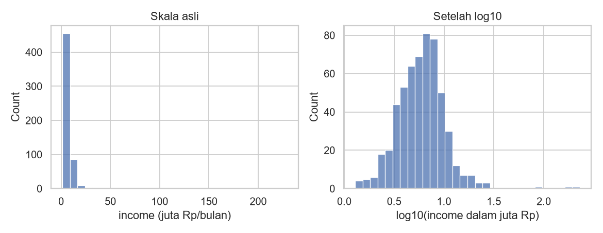
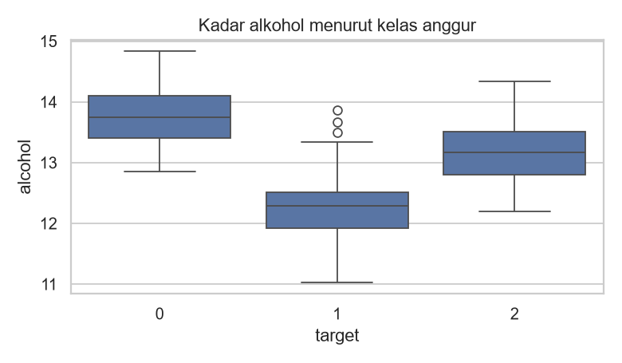
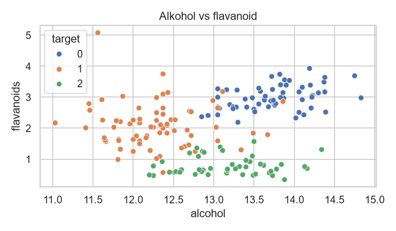
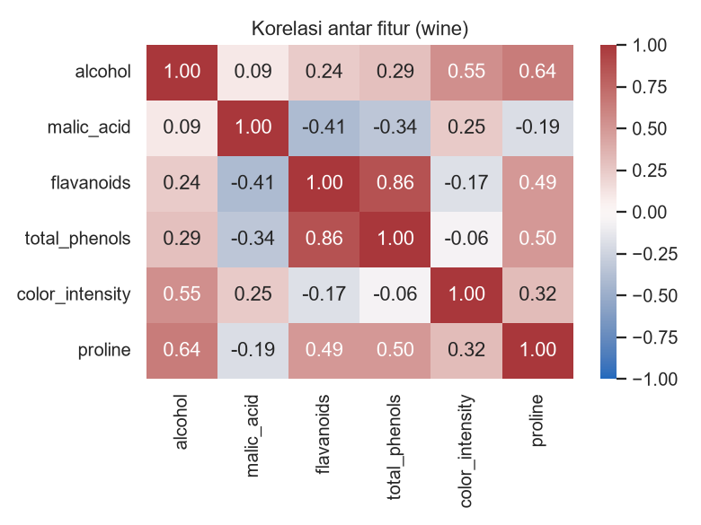

# Visualisasi Data dengan Matplotlib dan Seaborn

## Tujuan pembelajaran

- [x] Memilih jenis grafik sesuai pertanyaan dan jenis data.
- [x] Membuat histogram, *boxplot*, *scatter plot*, dan *heatmap* korelasi.
- [x] Membaca grafik secara kritis, termasuk efek *outlier*.

## Konsep dasar

Grafik membantu melihat pola yang tidak tampak dari angka. **Matplotlib** adalah pustaka dasarnya (`figure` berisi satu atau lebih `axes`); **Seaborn** dibangun di atasnya dan menyederhanakan grafik statistik dari `DataFrame`.

| Pertanyaan | Grafik |
|---|---|
| Bagaimana bentuk distribusi satu variabel numerik? | Histogram |
| Bagaimana distribusi dibandingkan antar kelompok, dan adakah *outlier*? | *Boxplot* |
| Apakah dua variabel numerik berhubungan? | *Scatter plot* |
| Bagaimana hubungan banyak variabel sekaligus? | *Heatmap* korelasi |
| Bagaimana perubahan menurut waktu? | Grafik garis (bab Forecasting) |

## Dataset

- **Data pelanggan sintetis** (lihat [pandas](pandas.md)) untuk histogram.
- **Wine** bawaan scikit-learn (`load_wine`): data publik 178 sampel hasil analisis kimia anggur dari tiga kultivar, 13 fitur numerik; target `target` berisi kelas 0, 1, 2. Dokumentasi: [scikit-learn toy datasets](https://scikit-learn.org/stable/datasets/toy_dataset.html).

## Implementasi langkah demi langkah

Program `examples/fundamentals/visualization.py` membuat empat gambar. Jalankan dari **root repositori** karena gambar disimpan ke `docs/assets/img/fundamentals/`. Program lengkap ada di akhir bagian ini.

### Langkah 1: menyiapkan pustaka dan data

```python title="visualization.py" linenums="1"
--8<-- "fundamentals/visualization.py:1:15"
```

| Kode | Penjelasan |
|---|---|
| `import matplotlib.pyplot as plt` | Modul `pyplot` dari Matplotlib, diberi nama pendek `plt`. |
| `import seaborn as sns` | Seaborn, nama pendek `sns`. |
| `OUT = Path(...)`; `OUT.mkdir(parents=True, exist_ok=True)` | Menentukan folder tujuan gambar dan membuatnya bila belum ada (`exist_ok=True` mencegah galat jika sudah ada). |
| `sns.set_theme(style="whitegrid")` | Memilih tema tampilan: latar putih dengan garis bantu abu-abu. |
| `load_wine(as_frame=True).frame` | Memuat dataset Wine sebagai `DataFrame`; kolom `target` berisi kelas anggur (0, 1, 2). |

**Konsep Matplotlib.** Satu gambar adalah `Figure` (kanvas); di dalamnya ada satu atau lebih `Axes` (area grafik dengan sumbu x dan y). `fig, ax = plt.subplots(...)` membuat keduanya; semua fungsi Seaborn di bawah menerima `ax=` agar grafiknya digambar di `Axes` tersebut.

### Langkah 2: histogram, bentuk distribusi satu variabel

**Pertanyaan yang dijawab:** bagaimana nilai `income` tersebar?

```python title="visualization.py" linenums="17"
--8<-- "fundamentals/visualization.py:17:28"
```

| Kode | Penjelasan |
|---|---|
| `df["income"].dropna() / 1e6` | Membuang nilai hilang (`dropna`) lalu membagi `1e6` (satu juta) agar satuannya "juta rupiah". |
| `plt.subplots(1, 2, figsize=(9, 3.5))` | Satu baris dengan **dua** grafik berdampingan; `figsize` = lebar dan tinggi dalam inci. `axes[0]` dan `axes[1]` adalah grafik kiri dan kanan. |
| `sns.histplot(..., bins=30)` | Membagi rentang nilai menjadi 30 kotak (*bin*) lalu menghitung berapa data di tiap kotak. |
| `np.log10(...)` | Logaritma basis 10: mengubah skala sehingga nilai sangat besar tidak lagi meregangkan sumbu. |
| `set_title`, `set_xlabel` | Judul dan label sumbu: **selalu beri** agar pembaca tahu isinya. |
| `fig.tight_layout()`, `fig.savefig(..., dpi=130)` | Merapikan jarak antar-elemen dan menyimpan gambar (`dpi` = ketajaman). |



**Cara membaca.** Sumbu-x adalah nilai income, sumbu-y adalah jumlah pelanggan (*count*) dalam tiap kotak. Pada skala asli (kiri) hampir semua data menumpuk di sisi kiri karena beberapa nilai ekstrem (sampai ratusan juta rupiah) memperlebar sumbu-x. Setelah `log10` (kanan), bentuk distribusi mendekati lonceng dan sisa *outlier* tampak jelas di sisi kanan. *Skewness* income pada data ini 13,78 (baris terakhir keluaran program), tanda kemiringan ekstrem ke kanan.

**Yang tidak dapat disimpulkan.** Histogram menunjukkan bentuk distribusi, bukan alasan kenapa nilai ekstrem muncul; itu perlu diperiksa pada datanya.

### Langkah 3: boxplot, membandingkan kelompok

**Pertanyaan:** apakah kadar alkohol berbeda antar kelas anggur?

```python title="visualization.py" linenums="30"
--8<-- "fundamentals/visualization.py:30:35"
```

`sns.boxplot(data=wine, x="target", y="alcohol")` menggambar satu kotak untuk tiap nilai `target` (sumbu-x), dengan nilai `alcohol` pada sumbu-y.



**Cara membaca.** Kotak memuat 50% data tengah (dari kuartil 1 ke kuartil 3), garis di dalam kotak adalah median, "kumis" menjangkau data yang masih wajar, dan titik di luar kumis adalah calon *outlier* (aturan IQR; lihat [Statistik](statistics.md)). Kotak yang berada pada tinggi berbeda menunjukkan sebaran alkohol yang berbeda antar kelas, sehingga fitur ini berpotensi membantu membedakan kelas. Tumpang-tindih antar-kotak berarti satu fitur ini saja tidak cukup memisahkan kelas.

### Langkah 4: scatter plot, hubungan dua variabel

```python title="visualization.py" linenums="37"
--8<-- "fundamentals/visualization.py:37:43"
```

`sns.scatterplot(x="alcohol", y="flavanoids", hue="target")`: tiap titik adalah satu anggur; posisi horizontal = alkohol, posisi vertikal = flavanoid; **warna** (`hue`) = kelas, dijelaskan oleh legenda di pojok grafik.



**Cara membaca.** Kombinasi dua fitur memisahkan kelas lebih baik daripada satu fitur saja: kelas 2 cenderung berflavanoid rendah, sedangkan kelas 0 beralkohol dan berflavanoid tinggi. Namun kelas 1 dan sebagian kelas lain tumpang tindih. Korelasi alkohol–flavanoid seluruh data hanya 0,24 (baris kedua keluaran): hubungan keseluruhan lemah, tetapi pola per kelas terlihat. **Korelasi bukan sebab-akibat**: grafik ini tidak membuktikan alkohol memengaruhi flavanoid atau sebaliknya.

### Langkah 5: heatmap korelasi

**Konsep.** `wine[cols].corr()` menghasilkan tabel korelasi Pearson antar-pasangan kolom (nilai -1 sampai +1). Heatmap mewarnai tiap sel menurut nilainya.

```python title="visualization.py" linenums="45"
--8<-- "fundamentals/visualization.py:45:52"
```

| Parameter | Arti |
|---|---|
| `annot=True`, `fmt=".2f"` | Menuliskan angka korelasi (dua desimal) di dalam sel. |
| `cmap="vlag"`, `center=0` | Palet biru-putih-merah dengan putih pada 0: satu warna untuk korelasi positif, warna lain untuk negatif. |
| `vmin=-1`, `vmax=1` | Mengunci rentang warna pada -1 sampai 1 agar warna konsisten. |



**Cara membaca.** Sumbu-x dan sumbu-y sama-sama berisi fitur, sehingga tabel simetris dan diagonalnya selalu 1 (korelasi fitur dengan dirinya). Cari sel berwarna pekat: korelasi kuat berarti dua fitur membawa informasi mirip. Ingat bahwa korelasi hanya mengukur hubungan **linear** dan bukan sebab-akibat (lihat [Statistik](statistics.md)).

### Langkah 6: keluaran teks

```python title="visualization.py" linenums="54"
--8<-- "fundamentals/visualization.py:54:56"
```

```text
--8<-- "expected/fundamentals/visualization.txt"
```

Program mencetak nama gambar yang tersimpan, korelasi `alcohol`–`flavanoids` (0,24), dan skewness income (13,78).

??? example "Program lengkap (`visualization.py`)"
    ```python title="visualization.py" linenums="1"
    --8<-- "fundamentals/visualization.py"
    ```

## Kesalahan umum

!!! warning "Hindari"
    - Membaca histogram tanpa memperhatikan skala sumbu yang terdistorsi *outlier*.
    - Memotong sumbu-y pada grafik batang sehingga selisih tampak berlebihan.
    - Memakai terlalu banyak warna atau tanpa judul dan label sumbu.
    - Membuat kesimpulan kausal dari *scatter plot*.
    - Tidak menyimpan grafik dengan `bbox`/`tight_layout` sehingga label terpotong.

## Latihan

1. Buat histogram `age` dari data pelanggan. Apakah distribusinya simetris?
2. Buat *boxplot* `flavanoids` menurut `target` pada wine.
3. Buat *scatter plot* `proline` vs `color_intensity`. Apakah kelas terpisah?
4. Tambahkan `annot=False` pada heatmap dan jelaskan apa yang hilang.

## Ringkasan

Pilih grafik sesuai pertanyaan: histogram (distribusi), boxplot (perbandingan dan outlier), scatter (hubungan), heatmap (korelasi). Selalu periksa skala dan jangan menarik kesimpulan kausal.

Berikutnya: [Statistik](statistics.md).
