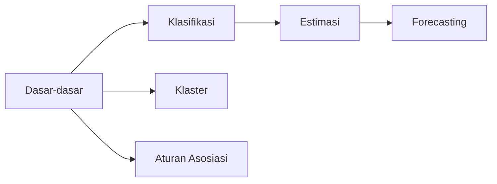

# Peta Belajar

Halaman ini menunjukkan urutan belajar dan alur kerja yang dipakai di seluruh bab.

## Urutan yang disarankan

- **Klasifikasi lebih dulu**, karena memperkenalkan *pipeline*, pembagian data, dan metrik yang dipakai ulang di bab lain.
- **Estimasi** menyusul karena hampir sama dengan klasifikasi, tetapi targetnya numerik.
- **Forecasting** setelah estimasi, karena model berbasis *lag* memakai regresi dan validasinya berurutan waktu.
- **Klaster** dan **Aturan Asosiasi** relatif mandiri dan dapat dipelajari setelah Dasar-dasar.

## Dua belas tahap alur kerja

Tidak semua tahap berlaku untuk semua jenis tugas. **W** = wajib, **O** = opsional, **B** = berlaku dengan cara berbeda, **T** = tidak berlaku.

| # | Tahap | Klasifikasi | Estimasi | Forecasting | Klaster | Asosiasi |
|---|---|---|---|---|---|---|
| 1 | Definisi masalah | W | W | W | W | W |
| 2 | Pengumpulan data | W | W | W | W | W |
| 3 | EDA | W | W | B | W | B |
| 4 | Praproses data | W | W | B | W | B |
| 5 | Rekayasa fitur | O | O | B | O | T |
| 6 | Pembagian data / validasi | W | W | B | T | T |
| 7 | Pemilihan model / metode | W | W | W | W | W |
| 8 | Pelatihan / penemuan pola | W | W | W | W | W |
| 9 | Prediksi dan evaluasi | W | W | B | B | B |
| 10 | Optimasi | W | W | W | O | O |
| 11 | Penyimpanan model | W | W | W | O | O |
| 12 | Deployment dan monitoring | O | O | O | O | O |

Keterangan perbedaan penting:

- **Forecasting:** pembagian data selalu kronologis; mengacak data menyebabkan kebocoran informasi dari masa depan.
- **Klaster:** tidak ada data uji berlabel; kualitas dinilai dengan indeks internal dan interpretasi.
- **Asosiasi:** data berupa transaksi; ukurannya *support*, *confidence*, dan *lift*, bukan *accuracy*.

## Pelajaran yang diajarkan sekali

Topik berikut dibahas di [Dasar-dasar](../fundamentals/index.md) dan dirujuk dari setiap bab: praproses data, pembagian data dan validasi silang, kebocoran data, metrik evaluasi, dan penyimpanan model.
